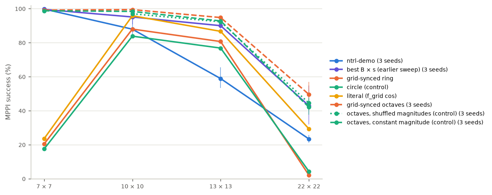
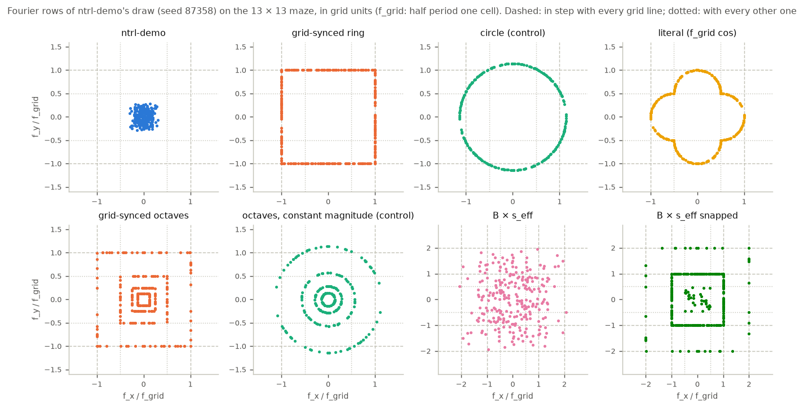

# Grid-synced Fourier features for ntrl-demo

Request (2026-11-02): test resonance with the grid. Make ntrl-demo's Fourier frequencies run in step with the n × n
grid, one cell being half a period; for a wave heading in a direction θ, scale its frequency with the direction ("half
the period would be grid size / cos θ ... cos θ = hyp / grid size"). See whether it makes the field more accurate, and
compare it with the ntrl-demo baseline for a few grid sizes.

Everything below is from registered runs (run ids in `report/tables.md` and on the findings page). Success = ntrl-demo's
MPPI over planning seeds 0/1/2, pooled over training seeds 87358/1/2 where a field has them (otherwise training seed
87358). Findings page: https://claude.ai/artifact/24TwpVguu8HWzgPoLumDBm (built by `page.py`; republish `report/grid_sync.html` with `freq.png`, `speed.png`, `profile.png`).

## Summary

1. **ntrl-demo's own features cannot resolve a cell beyond its demo maze.** Its Fourier rows reach at most 0.56, 0.39,
   0.30 and 0.18 of the grid frequency (half period = one cell) on the 7, 10, 13 and 22-cell mazes. ntrl-demo solves
   100 %, 88 %, 59 % and 23 % of the runs.
2. **The idea as stated, every feature at the grid frequency with |f| = f_grid / cos θ′ (the `ring`), draws walls
   sharply but is erratic at the maze scale.** On 10×10 and 13×13 it solves 88 % and 81 % of the
   runs (ntrl-demo with the same training seed: 83 % and 58 %), with the sharpest walls of any field there (near-wall
   slope 0.89 and 0.85 against 0.62 and 0.48; target 1).
   On 7×7 (20 %) and 22×22 (2 %) its long-range travel time collapses: a spectrum with only
   cell-scale waves has nothing direct to build maze-scale distances from, the learned T stops growing after a few cells
   (7×7: T/T* 0.27 over all queries, 0.12 at 8–16 cells, although its local speed fit is the best of any field, 0.97),
   and the field is full of local minima (6.88 and 28.07 per long true path; on 22×22 the minima
   sit at the cell centres). The circle control (same directions and mean frequency, no 1/cos θ′ correction) behaves
   the same: 18 %, 84 %, 77 %, 4 %.
3. **Grid-synced octaves fix that and beat ntrl-demo and every frequency scale of the earlier sweep.** Splitting the
   rows into octaves with half periods of 1, 2, 4, … cells, each row in step with every L-th grid line by the same
   1/cos θ′ rule (`octave`), gives 99 % on 10×10, 95 % on 13×13 and 50 % on
   22×22, against ntrl-demo's 88 %, 59 % and 23 % and the best
   hand-tuned frequency scale of the earlier sweep (95 %, 90 %,
   43 %), with no scale to tune: the grid sets it on every maze. On 7×7 it matches ntrl-demo
   (99 % against 100 %, one training seed). The field is also the most accurate one (median
   |log T/T*| 0.13 on 13×13 and 0.23 on 22×22 against 0.29 and
   0.27; held-out speed fit 0.80 against 0.32 on 22×22), except for the
   longest 22×22 trips, where ntrl-demo's smooth field estimates T better but plans none of them. For scale: the
   midpoint loss of `jeffrey/midpoint_dp` (a training change, same mazes and queries) reached 98 / 91 / 38 % on
   10 / 13 / 22 cells alone and 99 / 94 / 59 % on top of B × 3 / 3 / 6; the two were not combined here.
4. **The grid lock itself adds a little.** The same octaves with each row's magnitude shuffled within its octave (same
   magnitudes, same directions, no longer in step; `octaveperm`) and at constant magnitude (`octavecircle`) isolate it.
   Paired by training seed (same draw and network initialization; table "The lock" below), the synced octaves win
   3 of 3 seeds on 13×13 (2.5 points) and 4 of 5 on 22×22
   (5.1 points) against the shuffled control, 3 of 3 and 5 of 5
   (2.0 and 7.6 points) against the constant one; on 10×10 every octave field
   is near the ceiling and the comparison is mixed (2.4 and 1.1 points). The
   mechanism is a sharper wall barrier: the synced fields have the higher near-wall slope in every pair measured (22×22,
   seed 87358: 0.71 against 0.57 and 0.60) and hit fewer walls,
   while their local-minimum counts match the shuffled control's. Most of the gain over ntrl-demo comes from covering
   the cell scale at all, not from the exact lock.
5. **The other reading of the formula**, half period = one cell / cos θ′ (`literal`, |f| = f_grid · cos θ′), is in step
   with the grid crossings only for a traveller moving along the wave, not across the grid. It solves 24 %,
   96 %, 87 % and 29 % of the runs on the four mazes (seed 87358): better
   than the ring on the large mazes (its rows near 45° fall to half the grid frequency along the axes, a little coarser
   content), far below the octaves.

## Setup

**Mazes, data, planner, scoring** are those of `jeffrey/maze_scale` unchanged: the 7×7, 10×10, 13×13 and 22×22 mazes
(prepare runs `20261101T192446Z-9b1569db`, `20261102T032150Z-b0baa8e9`, `20261101T192504Z-13cf1d04`,
`20261101T193403Z-cea05796`), a 0.5 × 0.2-cell rectangle robot in SE(2), ntrl-demo's own training pairs, 40 certified
queries per travel-distance bin, ntrl-demo's MPPI scaled per cell, planning seeds 0/1/2, exact full-footprint scorer.
The ntrl-demo network, losses, optimizer, 5,000 epochs and the training seed's network initialization are unchanged:
the only change is the Fourier matrix B the network embeds its input with.

**ntrl-demo's embedding.** A configuration q = (x, y, φ) (x, y ∈ [−0.5, 0.5]; φ = 0.25 θ / E) enters as
[sin 2π Bq, cos 2π Bq], B (128 × 3) ~ N(0, 1) truncated at ±2. Each row is a plane wave with frequency vector
(f_x, f_y, f_φ) in cycles per normalized unit. The cell pitch is p = 1/E (E = n + 0.1), so the **grid frequency**
f_grid = 1/(2p) = E/2 is the frequency whose half period is exactly one cell. ntrl-demo's rows reach at most
0.56 / 0.39 / 0.30 / 0.18 f_grid on the 7 / 10 / 13 / 22 mazes (largest row of training seed 87358's draw): beyond 7×7
no input feature changes sign within a cell.

**Grid sync with direction.** Take a row with xy direction at angle θ′ to the nearest grid axis (0 ≤ θ′ ≤ 45°). Its
crests are lines perpendicular to that direction. Measured along its own direction they are λ/2 apart (half period);
measured along the grid axis they are λ/(2 cos θ′) apart, the hypotenuse of the right triangle whose leg is λ/2. For
every grid line to see the same phase (one cell = half a period along the axis, so a one-cell shift flips the feature's
sign), the hypotenuse must be one cell: λ/2 = p cos θ′, i.e. |f_xy| = f_grid / cos θ′. In the frequency plane these rows
sit on the square max(|f_x|, |f_y|) = f_grid. Read literally, "half period = grid size / cos θ" is the other right
triangle: λ/2 = p / cos θ′, |f_xy| = f_grid cos θ′. That wave is half a period per grid crossing for a traveller moving
along the wave's own direction, but across the grid a one-cell shift moves its phase by π cos²θ′, so the grid lines do
not all see the same phase (except at θ′ = 0). Both were run.

**Modes** (`features.py`; every mode keeps the directions and the φ column of the same seeded draw, so the network
init is identical; s_eff = f_grid / median row max(|f_x|, |f_y|) ≈ E / 1.9):

| mode | xy frequencies | in sync with the grid? |
|---|---|---|
| `ring` (the method) | \|f_xy\| = f_grid / cos θ′ (square) | every row, exactly (rows at 0° and 45° with both line families) |
| `circle` (control) | \|f_xy\| = c f_grid, c = mean of 1 / cos θ′ (1.14) | only where c cos θ′ = 1; median phase drift across the maze 2–7 rad |
| `literal` | \|f_xy\| = f_grid cos θ′ | only at θ′ = 0 |
| `octaveperm` (control) | the octave rows with their magnitudes shuffled within each octave (fixed permutation) | no (same magnitudes and directions as `octave`) |
| `octave` | rows sorted by ntrl-demo's \|f\|, K equal groups on the squares max(\|f_x\|, \|f_y\|) = f_grid / L, L = 2^(K−1) … 2, 1 (largest power of two ≤ n) | every row, with every L-th grid line |
| `octavecircle` (control) | the same octaves at constant magnitude 1.14 f_grid / L | no |

`features.py` also defines `scaled` (B × s_eff), `snap` (B × s_eff with the upper rows on grid harmonics) and
`ringhalf` / `circlehalf` (half ntrl-demo rows, half ring / circle rows). They were queued as further variants and
dropped unrun once the octaves answered the same questions; the GPU was shared with another study.

`octave` is the multi-scale version of the ring, added after the pure ring collapsed on 22×22 (a spectrum at the grid
frequency only has nothing to build the maze-scale part of T from); `octavecircle` is its control. φ column: × s_eff in every mode (s_eff ∝ E and φ ∝ 1/E, so the heading frequencies per radian are the same on every
maze). `circle` has the ring's mean frequency and the same directions, so `ring` vs `circle` isolates the direction
correction (sync) for a single frequency; `octave` vs `octaveperm` isolates the lock with everything else identical.

## Results

## Success, training seed 87358 (MPPI, planning seeds 0/1/2)

| field | 7×7 | 10×10 | 13×13 | 22×22 |
|---|---|---|---|---|
| ntrl-demo | 100 % (480/480) | 83 % (500/600) | 58 % (347/600) | 21 % (152/720) |
| B × 1.5 | 99 % (477/480) | 86 % (513/600) | 74 % (441/600) | 22 % (159/720) |
| B × 3 | 81 % (391/480) | 99 % (592/600) | 92 % (554/600) | 29 % (212/720) |
| B × 6 | – | 51 % (304/600) | 91 % (548/600) | 42 % (302/720) |
| grid-synced ring (f = f_grid / cos θ′) | 20 % (98/480) | 88 % (528/600) | 81 % (484/600) | 2 % (15/720) |
| circle control (constant f) | 18 % (84/480) | 84 % (503/600) | 77 % (461/600) | 4 % (31/720) |
| literal (f = f_grid · cos θ′) | 24 % (113/480) | 96 % (575/600) | 87 % (520/600) | 29 % (211/720) |
| B × s_eff (Gaussian disk) | – | – | – | – |
| B × s_eff, upper rows snapped to grid harmonics | – | – | – | – |
| half ntrl-demo rows + half ring rows | – | – | – | – |
| half ntrl-demo rows + half circle rows | – | – | – | – |
| grid-synced octaves (half period 1, 2, 4, … cells) | 99 % (476/480) | 100 % (598/600) | 95 % (569/600) | 57 % (410/720) |
| octaves at constant magnitude (control) | 99 % (474/480) | 96 % (575/600) | 94 % (564/600) | 47 % (336/720) |
| octave magnitudes shuffled within octaves (control) | – | 95 % (569/600) | 93 % (556/600) | 48 % (343/720) |

#### Success, training seeds 87358 / 1 / 2 pooled ([per seed])

| field | 7×7 | 10×10 | 13×13 | 22×22 |
|---|---|---|---|---|
| ntrl-demo | 100 % (1437/1440) [480 / 480 / 477] | 88 % (1583/1800) [500 / 523 / 560] | 59 % (1060/1800) [347 / 320 / 393] | 23 % (505/2160) [152 / 186 / 167] |
| B × 1.5 | 100 % (1434/1440) [477 / 480 / 477] | 93 % (1679/1800) [513 / 581 / 585] | 76 % (1364/1800) [441 / 450 / 473] | 24 % (513/2160) [159 / 179 / 175] |
| B × 3 | 78 % (1117/1440) [391 / 345 / 381] | 95 % (1712/1800) [592 / 575 / 545] | 90 % (1620/1800) [554 / 529 / 537] | 27 % (588/2160) [212 / 175 / 201] |
| B × 6 | – | 51 % (304/600) | 91 % (548/600) | 43 % (926/2160) [302 / 229 / 395] |
| grid-synced ring (f = f_grid / cos θ′) | 20 % (98/480) | 88 % (528/600) | 81 % (484/600) | 2 % (15/720) |
| circle control (constant f) | 18 % (84/480) | 84 % (503/600) | 77 % (461/600) | 4 % (31/720) |
| literal (f = f_grid · cos θ′) | 24 % (113/480) | 96 % (575/600) | 87 % (520/600) | 29 % (211/720) |
| B × s_eff (Gaussian disk) | – | – | – | – |
| B × s_eff, upper rows snapped to grid harmonics | – | – | – | – |
| half ntrl-demo rows + half ring rows | – | – | – | – |
| half ntrl-demo rows + half circle rows | – | – | – | – |
| grid-synced octaves (half period 1, 2, 4, … cells) | 99 % (476/480) | 99 % (1790/1800) [598 / 600 / 592] | 95 % (1706/1800) [569 / 573 / 564] | 50 % (1071/2160) [410 / 327 / 334] |
| octaves at constant magnitude (control) | 99 % (474/480) | 98 % (1771/1800) [575 / 600 / 596] | 93 % (1670/1800) [564 / 555 / 551] | 42 % (909/2160) [336 / 302 / 271] |
| octave magnitudes shuffled within octaves (control) | – | 97 % (1746/1800) [569 / 580 / 597] | 92 % (1661/1800) [556 / 554 / 551] | 44 % (961/2160) [343 / 328 / 290] |

#### The lock: grid-synced octaves against the two octave controls, paired by training seed (every seed run)

Same seed = same Fourier draw (directions) and the same network initialization; runs solved of 3 × queries.

| maze | seed | octave | shuffled magnitudes | constant magnitude | octave − shuffled | octave − constant |
|---|---|---|---|---|---|---|
| 7×7 | 87358 | 476 | – | 474 | – | +2 |
| 10×10 | 87358 | 598 | 569 | 575 | +29 | +23 |
| 10×10 | 1 | 600 | 580 | 600 | +20 | +0 |
| 10×10 | 2 | 592 | 597 | 596 | -5 | -4 |
| 13×13 | 87358 | 569 | 556 | 564 | +13 | +5 |
| 13×13 | 1 | 573 | 554 | 555 | +19 | +18 |
| 13×13 | 2 | 564 | 551 | 551 | +13 | +13 |
| 22×22 | 87358 | 410 | 343 | 336 | +67 | +74 |
| 22×22 | 1 | 327 | 328 | 302 | -1 | +25 |
| 22×22 | 2 | 334 | 290 | 271 | +44 | +63 |
| 22×22 | 3 | 351 | 307 | 297 | +44 | +54 |
| 22×22 | 4 | 342 | 311 | 285 | +31 | +57 |

#### Field accuracy, training seed 87358

median |log(T/T*)| over all queries / held-out log-speed correlation / median descent cosine at the start

| field | 7×7 | 10×10 | 13×13 | 22×22 |
|---|---|---|---|---|
| ntrl-demo | 0.048 / 0.92 / 0.94 | 0.229 / 0.79 / 0.90 | 0.279 / 0.67 / 0.88 | 0.243 / 0.31 / 0.76 |
| B × 1.5 | 0.042 / 0.94 / 0.95 | 0.191 / 0.85 / 0.90 | 0.248 / 0.74 / 0.90 | 0.275 / 0.36 / 0.83 |
| B × 3 | 0.054 / 0.96 / 0.92 | 0.125 / 0.89 / 0.93 | 0.180 / 0.84 / 0.91 | 0.315 / 0.56 / 0.87 |
| B × 6 | – | 0.228 / 0.93 / 0.88 | 0.157 / 0.89 / 0.90 | 0.456 / 0.68 / 0.85 |
| grid-synced ring (f = f_grid / cos θ′) | 1.295 / 0.97 / 0.70 | 0.118 / 0.94 / 0.89 | 0.146 / 0.91 / 0.86 | 2.050 / 0.40 / 0.15 |
| circle control (constant f) | 1.571 / 0.96 / 0.62 | 0.144 / 0.93 / 0.89 | 0.159 / 0.88 / 0.86 | 2.016 / 0.51 / 0.10 |
| literal (f = f_grid · cos θ′) | 1.161 / 0.96 / 0.74 | 0.113 / 0.93 / 0.89 | 0.152 / 0.90 / 0.90 | 0.426 / 0.77 / 0.67 |
| B × s_eff (Gaussian disk) | – | – | – | – |
| B × s_eff, upper rows snapped to grid harmonics | – | – | – | – |
| half ntrl-demo rows + half ring rows | – | – | – | – |
| half ntrl-demo rows + half circle rows | – | – | – | – |
| grid-synced octaves (half period 1, 2, 4, … cells) | 0.033 / 0.95 / 0.95 | 0.111 / 0.91 / 0.92 | 0.135 / 0.89 / 0.92 | 0.250 / 0.82 / 0.83 |
| octaves at constant magnitude (control) | 0.038 / 0.95 / 0.95 | 0.123 / 0.90 / 0.92 | 0.143 / 0.87 / 0.90 | 0.282 / 0.77 / 0.86 |
| octave magnitudes shuffled within octaves (control) | – | 0.132 / 0.89 / 0.92 | 0.131 / 0.87 / 0.92 | 0.259 / 0.76 / 0.84 |

#### By distance bin, training seed 87358: success % and median |log(T/T*)|

**7×7**

| field | 0.5-2 | 2-4 | 4-8 | 8-16 |
|---|---|---|---|---|
| ntrl-demo | 100 % / 0.04 | 100 % / 0.04 | 100 % / 0.05 | 100 % / 0.06 |
| B × 1.5 | 100 % / 0.05 | 100 % / 0.03 | 98 % / 0.04 | 100 % / 0.05 |
| B × 3 | 100 % / 0.06 | 98 % / 0.04 | 81 % / 0.06 | 48 % / 0.07 |
| grid-synced ring (f = f_grid / cos θ′) | 76 % / 0.18 | 6 % / 1.07 | 0 % / 1.65 | 0 % / 2.15 |
| circle control (constant f) | 70 % / 0.29 | 0 % / 1.26 | 0 % / 1.86 | 0 % / 2.33 |
| literal (f = f_grid · cos θ′) | 85 % / 0.15 | 9 % / 0.87 | 0 % / 1.36 | 0 % / 1.93 |
| grid-synced octaves (half period 1, 2, 4, … cells) | 100 % / 0.06 | 100 % / 0.03 | 98 % / 0.03 | 99 % / 0.03 |
| octaves at constant magnitude (control) | 100 % / 0.05 | 100 % / 0.03 | 95 % / 0.03 | 100 % / 0.04 |

**10×10**

| field | 0.5-2 | 2-4 | 4-8 | 8-16 | 16-32 |
|---|---|---|---|---|---|
| ntrl-demo | 98 % / 0.08 | 88 % / 0.13 | 98 % / 0.20 | 82 % / 0.38 | 51 % / 0.60 |
| B × 1.5 | 100 % / 0.05 | 92 % / 0.11 | 90 % / 0.18 | 72 % / 0.33 | 73 % / 0.57 |
| B × 3 | 100 % / 0.05 | 100 % / 0.04 | 100 % / 0.12 | 97 % / 0.26 | 97 % / 0.45 |
| B × 6 | 98 % / 0.08 | 85 % / 0.07 | 58 % / 0.18 | 12 % / 0.64 | 0 % / 0.56 |
| grid-synced ring (f = f_grid / cos θ′) | 100 % / 0.09 | 90 % / 0.06 | 87 % / 0.10 | 80 % / 0.14 | 83 % / 0.29 |
| circle control (constant f) | 90 % / 0.09 | 80 % / 0.07 | 90 % / 0.07 | 82 % / 0.21 | 78 % / 0.37 |
| literal (f = f_grid · cos θ′) | 98 % / 0.06 | 95 % / 0.03 | 98 % / 0.06 | 92 % / 0.18 | 97 % / 0.37 |
| grid-synced octaves (half period 1, 2, 4, … cells) | 100 % / 0.05 | 100 % / 0.04 | 100 % / 0.10 | 100 % / 0.24 | 98 % / 0.42 |
| octaves at constant magnitude (control) | 100 % / 0.03 | 100 % / 0.07 | 99 % / 0.10 | 94 % / 0.25 | 86 % / 0.43 |
| octave magnitudes shuffled within octaves (control) | 100 % / 0.05 | 99 % / 0.06 | 97 % / 0.13 | 96 % / 0.26 | 82 % / 0.47 |

**13×13**

| field | 0.5-2 | 2-4 | 4-8 | 8-16 | 16-32 |
|---|---|---|---|---|---|
| ntrl-demo | 92 % / 0.10 | 75 % / 0.18 | 48 % / 0.25 | 48 % / 0.64 | 27 % / 0.71 |
| B × 1.5 | 92 % / 0.12 | 85 % / 0.15 | 76 % / 0.19 | 71 % / 0.61 | 43 % / 0.68 |
| B × 3 | 98 % / 0.08 | 98 % / 0.09 | 92 % / 0.13 | 89 % / 0.46 | 85 % / 0.53 |
| B × 6 | 100 % / 0.08 | 92 % / 0.08 | 91 % / 0.10 | 91 % / 0.42 | 82 % / 0.43 |
| grid-synced ring (f = f_grid / cos θ′) | 100 % / 0.07 | 85 % / 0.10 | 82 % / 0.12 | 85 % / 0.34 | 51 % / 0.35 |
| circle control (constant f) | 95 % / 0.07 | 85 % / 0.09 | 78 % / 0.15 | 79 % / 0.44 | 48 % / 0.44 |
| literal (f = f_grid · cos θ′) | 100 % / 0.07 | 91 % / 0.11 | 88 % / 0.10 | 92 % / 0.35 | 62 % / 0.35 |
| grid-synced octaves (half period 1, 2, 4, … cells) | 100 % / 0.04 | 92 % / 0.09 | 92 % / 0.09 | 98 % / 0.29 | 92 % / 0.35 |
| octaves at constant magnitude (control) | 100 % / 0.07 | 95 % / 0.08 | 88 % / 0.10 | 97 % / 0.34 | 90 % / 0.38 |
| octave magnitudes shuffled within octaves (control) | 100 % / 0.07 | 95 % / 0.07 | 89 % / 0.11 | 96 % / 0.33 | 83 % / 0.36 |

**22×22**

| field | 0.5-2 | 2-4 | 4-8 | 8-16 | 16-32 | 32-64 |
|---|---|---|---|---|---|---|
| ntrl-demo | 75 % / 0.17 | 22 % / 0.23 | 10 % / 0.27 | 15 % / 0.31 | 5 % / 0.31 | 0 % / 0.15 |
| B × 1.5 | 74 % / 0.16 | 36 % / 0.25 | 11 % / 0.30 | 12 % / 0.33 | 0 % / 0.33 | 0 % / 0.23 |
| B × 3 | 83 % / 0.19 | 43 % / 0.20 | 28 % / 0.30 | 15 % / 0.39 | 8 % / 0.37 | 0 % / 0.34 |
| B × 6 | 85 % / 0.20 | 70 % / 0.19 | 43 % / 0.42 | 32 % / 0.55 | 21 % / 0.59 | 1 % / 0.57 |
| grid-synced ring (f = f_grid / cos θ′) | 12 % / 0.31 | 0 % / 1.16 | 0 % / 1.79 | 0 % / 2.36 | 0 % / 2.94 | 0 % / 3.44 |
| circle control (constant f) | 26 % / 0.31 | 0 % / 1.01 | 0 % / 1.67 | 0 % / 2.39 | 0 % / 2.96 | 0 % / 3.43 |
| literal (f = f_grid · cos θ′) | 82 % / 0.22 | 55 % / 0.40 | 25 % / 0.42 | 13 % / 0.55 | 1 % / 0.46 | 0 % / 0.50 |
| grid-synced octaves (half period 1, 2, 4, … cells) | 98 % / 0.14 | 88 % / 0.08 | 48 % / 0.20 | 43 % / 0.29 | 32 % / 0.36 | 33 % / 0.40 |
| octaves at constant magnitude (control) | 95 % / 0.14 | 78 % / 0.11 | 57 % / 0.18 | 24 % / 0.29 | 21 % / 0.39 | 5 % / 0.43 |
| octave magnitudes shuffled within octaves (control) | 92 % / 0.14 | 72 % / 0.14 | 45 % / 0.20 | 33 % / 0.27 | 36 % / 0.38 | 8 % / 0.42 |

#### Failure type, training seed 87358 (all planning seeds)

runs that never converged (stalls) / converged runs with a collision

| field | 7×7 | 10×10 | 13×13 | 22×22 |
|---|---|---|---|---|
| ntrl-demo | 0 / 0 | 15 / 85 | 5 / 248 | 79 / 489 |
| B × 1.5 | 3 / 0 | 6 / 81 | 15 / 144 | 77 / 484 |
| B × 3 | 89 / 0 | 1 / 7 | 20 / 26 | 110 / 398 |
| B × 6 | – | 296 / 0 | 31 / 21 | 224 / 194 |
| grid-synced ring (f = f_grid / cos θ′) | 382 / 0 | 68 / 4 | 116 / 0 | 702 / 3 |
| circle control (constant f) | 396 / 0 | 96 / 1 | 139 / 0 | 689 / 0 |
| literal (f = f_grid · cos θ′) | 367 / 0 | 25 / 0 | 69 / 11 | 488 / 21 |
| B × s_eff (Gaussian disk) | – | – | – | – |
| B × s_eff, upper rows snapped to grid harmonics | – | – | – | – |
| half ntrl-demo rows + half ring rows | – | – | – | – |
| half ntrl-demo rows + half circle rows | – | – | – | – |
| grid-synced octaves (half period 1, 2, 4, … cells) | 4 / 0 | 0 / 2 | 24 / 7 | 192 / 118 |
| octaves at constant magnitude (control) | 6 / 0 | 4 / 21 | 17 / 19 | 139 / 245 |
| octave magnitudes shuffled within octaves (control) | – | 8 / 23 | 19 / 25 | 136 / 241 |

#### Run ids

- 7×7 ntrl-demo seed 87358: 20261101T200440Z-b920137d
- 7×7 ntrl-demo seed 1: 20261101T201244Z-1ae74c20
- 7×7 ntrl-demo seed 2: 20261101T202527Z-32f7835e
- 7×7 B × 1.5 seed 87358: 20261102T020329Z-e5dfdec7
- 7×7 B × 1.5 seed 1: 20261102T030803Z-41ecc7f5
- 7×7 B × 1.5 seed 2: 20261102T032233Z-b9933397
- 7×7 B × 3 seed 87358: 20261102T021830Z-78506dae
- 7×7 B × 3 seed 1: 20261102T031511Z-7accf582
- 7×7 B × 3 seed 2: 20261102T033312Z-61d34895
- 7×7 ring seed 87358: 20261103T022616Z-338f643e
- 7×7 circle seed 87358: 20261103T023436Z-54b5d14c
- 7×7 literal seed 87358: 20261103T050136Z-447540af
- 7×7 octave seed 87358: 20261103T024259Z-a5bf17a0
- 7×7 octavecircle seed 87358: 20261103T025131Z-a1b8a806
- 10×10 ntrl-demo seed 87358: 20261102T032216Z-e76476bf
- 10×10 ntrl-demo seed 1: 20261102T033305Z-5d802f80
- 10×10 ntrl-demo seed 2: 20261102T032238Z-09a41392
- 10×10 B × 1.5 seed 87358: 20261102T034323Z-06e20c41
- 10×10 B × 1.5 seed 1: 20261102T045255Z-60d56038
- 10×10 B × 1.5 seed 2: 20261102T050822Z-51684090
- 10×10 B × 3 seed 87358: 20261102T040322Z-06099883
- 10×10 B × 3 seed 1: 20261102T050643Z-d64a530a
- 10×10 B × 3 seed 2: 20261102T051954Z-3166a3d5
- 10×10 B × 6 seed 87358: 20261102T053250Z-a7a5f74b
- 10×10 ring seed 87358: 20261102T211322Z-208ddefa
- 10×10 circle seed 87358: 20261103T015321Z-09893401
- 10×10 literal seed 87358: 20261103T045356Z-b3124c1f
- 10×10 octave seed 87358: 20261103T020200Z-c1c98536
- 10×10 octave seed 1: 20261103T030135Z-0aa1bd87
- 10×10 octave seed 2: 20261103T031739Z-5c625e44
- 10×10 octavecircle seed 87358: 20261103T021009Z-c21a3862
- 10×10 octavecircle seed 1: 20261103T030933Z-01456134
- 10×10 octavecircle seed 2: 20261103T032543Z-296c34fd
- 10×10 octaveperm seed 87358: 20261103T021807Z-8bd0de42
- 10×10 octaveperm seed 1: 20261103T033333Z-62734064
- 10×10 octaveperm seed 2: 20261103T034124Z-11ce6f89
- 13×13 ntrl-demo seed 87358: 20261101T203437Z-ebc95225
- 13×13 ntrl-demo seed 1: 20261101T204630Z-58badec5
- 13×13 ntrl-demo seed 2: 20261101T205900Z-c57aa0f1
- 13×13 B × 1.5 seed 87358: 20261102T013121Z-b06262b1
- 13×13 B × 1.5 seed 1: 20261102T023222Z-3a56befa
- 13×13 B × 1.5 seed 2: 20261102T024644Z-3a043499
- 13×13 B × 3 seed 87358: 20261102T014741Z-dbca8e69
- 13×13 B × 3 seed 1: 20261102T023943Z-95b7bd4e
- 13×13 B × 3 seed 2: 20261102T025340Z-27b1eeb6
- 13×13 B × 6 seed 87358: 20261102T030050Z-ba473310
- 13×13 ring seed 87358: 20261102T204749Z-e2b2c1d1
- 13×13 circle seed 87358: 20261102T210518Z-5c13deba
- 13×13 literal seed 87358: 20261103T034919Z-a14b5b39
- 13×13 octave seed 87358: 20261102T231704Z-952dc19f
- 13×13 octave seed 1: 20261103T005705Z-20429171
- 13×13 octave seed 2: 20261103T011315Z-5587c3f4
- 13×13 octavecircle seed 87358: 20261102T232517Z-1ed73030
- 13×13 octavecircle seed 1: 20261103T010508Z-229bcd54
- 13×13 octavecircle seed 2: 20261103T012111Z-fad3391b
- 13×13 octaveperm seed 87358: 20261103T012907Z-0d652f04
- 13×13 octaveperm seed 1: 20261103T013714Z-9831c88d
- 13×13 octaveperm seed 2: 20261103T014516Z-ef4655b8
- 22×22 ntrl-demo seed 87358: 20261101T193703Z-dd44f02b
- 22×22 ntrl-demo seed 1: 20261101T194908Z-fa2678e3
- 22×22 ntrl-demo seed 2: 20261101T200614Z-92e8b351
- 22×22 B × 1.5 seed 87358: 20261102T013121Z-43f0d2a6
- 22×22 B × 1.5 seed 1: 20261102T024342Z-99e8720e
- 22×22 B × 1.5 seed 2: 20261102T025846Z-5d245bb2
- 22×22 B × 3 seed 87358: 20261102T020330Z-43726de5
- 22×22 B × 3 seed 1: 20261102T025104Z-ee745369
- 22×22 B × 3 seed 2: 20261102T030623Z-773d873b
- 22×22 B × 6 seed 87358: 20261102T032133Z-9d61cff5
- 22×22 B × 6 seed 1: 20261102T050535Z-7879ad1e
- 22×22 B × 6 seed 2: 20261102T051820Z-834b2691
- 22×22 ring seed 87358: 20261102T205626Z-8b4a2b28
- 22×22 circle seed 87358: 20261102T235043Z-404c8725
- 22×22 literal seed 87358: 20261103T035709Z-8f28a39c
- 22×22 octave seed 87358: 20261102T233320Z-7ec5e948
- 22×22 octave seed 1: 20261103T000737Z-76c367c9
- 22×22 octave seed 2: 20261103T003224Z-4ebdaec0
- 22×22 octave seed 3: 20261103T040549Z-da0e41dd
- 22×22 octave seed 4: 20261103T042941Z-83155328
- 22×22 octavecircle seed 87358: 20261102T234207Z-fd86594f
- 22×22 octavecircle seed 1: 20261103T001558Z-bb4f3e04
- 22×22 octavecircle seed 2: 20261103T004044Z-3083d328
- 22×22 octavecircle seed 3: 20261103T041351Z-c7787b1a
- 22×22 octavecircle seed 4: 20261103T043755Z-f6eb920d
- 22×22 octaveperm seed 87358: 20261102T235914Z-67f338ec
- 22×22 octaveperm seed 1: 20261103T002409Z-1d92f51b
- 22×22 octaveperm seed 2: 20261103T004857Z-6160a087
- 22×22 octaveperm seed 3: 20261103T042141Z-45ec79e2
- 22×22 octaveperm seed 4: 20261103T044600Z-f9b5a5bc

## Mechanism

Training seed(s) 87358. Doorway dip: learned speed at the middle of a free doorway over the speed half a cell either side (1 = no phantom wall; truth 1). Phantom share: doorways slowed to half speed or less. Wall S@0.35: learned speed 0.35 cells from a wall line (truth: the trained label, given). Bumps: local minima of T(x, goal) along true paths of queries >= 8 cells. Near-wall slope / cos at gap 2-8 cells (targets 1 / 1).

| maze | field | doorway dip (median, q10) | phantom share | wall S@0.35 (label) | bumps per long path | near-wall slope / cos (gap 2-8) |
|---|---|---|---|---|---|---|
| 7×7 | ntrl-demo (seed 87358) | 1.00 (0.94) | 0 % | 0.163 (0.221) | 0.05 | 0.86 / 0.98 |
| 7×7 | B × 1.5 (seed 87358) | 1.01 (0.91) | 0 % | 0.156 (0.221) | 0.05 | 0.88 / 0.99 |
| 7×7 | B × 3 (seed 87358) | 1.04 (0.92) | 0 % | 0.169 (0.221) | 0.65 | 0.94 / 0.99 |
| 7×7 | grid-synced ring (f = f_grid / cos θ′) (seed 87358) | 0.98 (0.86) | 0 % | 0.177 (0.221) | 6.88 | 1.00 / 1.00 |
| 7×7 | circle control (constant f) (seed 87358) | 1.01 (0.83) | 0 % | 0.178 (0.221) | 10.90 | 0.94 / 0.99 |
| 7×7 | literal (f = f_grid · cos θ′) (seed 87358) | 1.05 (0.81) | 0 % | 0.167 (0.221) | 8.30 | 0.98 / 0.99 |
| 7×7 | grid-synced octaves (half period 1, 2, 4, … cells) (seed 87358) | 0.98 (0.93) | 0 % | 0.148 (0.221) | 0.05 | 0.93 / 0.99 |
| 7×7 | octaves at constant magnitude (control) (seed 87358) | 0.99 (0.89) | 0 % | 0.166 (0.221) | 0.05 | 0.90 / 0.99 |
| 10×10 | ntrl-demo (seed 87358) | 0.96 (0.70) | 0 % | 0.194 (0.221) | 0.04 | 0.62 / 0.96 |
| 10×10 | B × 1.5 (seed 87358) | 0.94 (0.76) | 0 % | 0.195 (0.221) | 0.10 | 0.68 / 0.97 |
| 10×10 | B × 3 (seed 87358) | 0.95 (0.75) | 0 % | 0.140 (0.221) | 0.14 | 0.80 / 0.98 |
| 10×10 | B × 6 (seed 87358) | 0.99 (0.77) | 0 % | 0.149 (0.221) | 2.16 | 0.90 / 0.98 |
| 10×10 | grid-synced ring (f = f_grid / cos θ′) (seed 87358) | 0.96 (0.71) | 1 % | 0.159 (0.221) | 0.54 | 0.89 / 0.99 |
| 10×10 | circle control (constant f) (seed 87358) | 0.99 (0.76) | 0 % | 0.161 (0.221) | 0.38 | 0.89 / 0.99 |
| 10×10 | literal (f = f_grid · cos θ′) (seed 87358) | 1.00 (0.75) | 0 % | 0.167 (0.221) | 0.24 | 0.85 / 0.98 |
| 10×10 | grid-synced octaves (half period 1, 2, 4, … cells) (seed 87358) | 0.96 (0.78) | 0 % | 0.151 (0.221) | 0.04 | 0.87 / 0.98 |
| 10×10 | octaves at constant magnitude (control) (seed 87358) | 0.97 (0.77) | 0 % | 0.178 (0.221) | 0.14 | 0.80 / 0.98 |
| 10×10 | octave magnitudes shuffled within octaves (control) (seed 87358) | 0.94 (0.78) | 0 % | 0.160 (0.221) | 0.09 | 0.84 / 0.98 |
| 13×13 | ntrl-demo (seed 87358) | 0.97 (0.75) | 0 % | 0.247 (0.221) | 0.06 | 0.48 / 0.92 |
| 13×13 | B × 1.5 (seed 87358) | 0.96 (0.74) | 1 % | 0.200 (0.221) | 0.07 | 0.56 / 0.94 |
| 13×13 | B × 3 (seed 87358) | 0.97 (0.73) | 0 % | 0.152 (0.221) | 0.07 | 0.68 / 0.96 |
| 13×13 | B × 6 (seed 87358) | 0.96 (0.71) | 1 % | 0.149 (0.221) | 0.05 | 0.79 / 0.98 |
| 13×13 | grid-synced ring (f = f_grid / cos θ′) (seed 87358) | 1.01 (0.71) | 1 % | 0.147 (0.221) | 0.41 | 0.85 / 0.98 |
| 13×13 | circle control (constant f) (seed 87358) | 0.98 (0.65) | 3 % | 0.156 (0.221) | 0.41 | 0.80 / 0.98 |
| 13×13 | literal (f = f_grid · cos θ′) (seed 87358) | 0.98 (0.71) | 1 % | 0.150 (0.221) | 0.19 | 0.84 / 0.98 |
| 13×13 | grid-synced octaves (half period 1, 2, 4, … cells) (seed 87358) | 0.97 (0.78) | 0 % | 0.178 (0.221) | 0.04 | 0.78 / 0.98 |
| 13×13 | octaves at constant magnitude (control) (seed 87358) | 0.98 (0.80) | 0 % | 0.178 (0.221) | 0.01 | 0.74 / 0.97 |
| 13×13 | octave magnitudes shuffled within octaves (control) (seed 87358) | 0.99 (0.80) | 0 % | 0.166 (0.221) | 0.04 | 0.77 / 0.98 |
| 22×22 | ntrl-demo (seed 87358) | 0.96 (0.78) | 0 % | 0.550 (0.221) | 1.86 | 0.24 / 0.56 |
| 22×22 | B × 1.5 (seed 87358) | 0.95 (0.75) | 0 % | 0.512 (0.221) | 1.63 | 0.26 / 0.63 |
| 22×22 | B × 3 (seed 87358) | 1.01 (0.80) | 0 % | 0.274 (0.221) | 0.96 | 0.37 / 0.83 |
| 22×22 | B × 6 (seed 87358) | 1.03 (0.74) | 1 % | 0.174 (0.221) | 0.56 | 0.51 / 0.91 |
| 22×22 | grid-synced ring (f = f_grid / cos θ′) (seed 87358) | 1.23 (0.78) | 0 % | 0.810 (0.221) | 28.07 | 0.25 / 0.81 |
| 22×22 | circle control (constant f) (seed 87358) | 1.05 (0.77) | 0 % | 0.858 (0.221) | 21.25 | 0.32 / 0.84 |
| 22×22 | literal (f = f_grid · cos θ′) (seed 87358) | 0.98 (0.62) | 2 % | 0.177 (0.221) | 3.53 | 0.70 / 0.95 |
| 22×22 | grid-synced octaves (half period 1, 2, 4, … cells) (seed 87358) | 0.97 (0.74) | 0 % | 0.178 (0.221) | 0.28 | 0.71 / 0.97 |
| 22×22 | octaves at constant magnitude (control) (seed 87358) | 1.03 (0.79) | 0 % | 0.236 (0.221) | 0.17 | 0.60 / 0.95 |
| 22×22 | octave magnitudes shuffled within octaves (control) (seed 87358) | 1.00 (0.75) | 1 % | 0.259 (0.221) | 0.23 | 0.57 / 0.95 |

**Where the local minima sit.** Local minima of T(x, goal) along the true paths of queries >= 8 cells; phase = position along the direction of travel modulo one cell (0 = grid line, 0.5 = cell centre). R = concentration of the phases (0 = even; chance level about 1/sqrt(count)). Path reference: all path samples. Ripple: the field error along the true paths minus its two-cell moving average, relative to the query travel time; locked share = fraction of the ripple variance explained by the position within the cell.

| maze | field | seed | minima | R (chance) | mean phase | histogram (10 bins from the grid line) | ripple rms | locked share | minima inside the wall margin |
|---|---|---|---|---|---|---|---|---|---|
| 13×13 | B × 6 | 87358 | 4 | 0.25 (0.50) | 0.61 | 1 0 0 0 1 1 0 1 0 0 | 0.0058 | 0.008 | 2/4 (path 33 %) |
| 13×13 | ntrl-demo | 1 | 5 | 0.30 (0.45) | 0.71 | 0 1 0 0 0 1 1 1 1 0 | 0.0075 | 0.004 | 3/5 (path 33 %) |
| 13×13 | ntrl-demo | 87358 | 5 | 0.23 (0.45) | 0.51 | 0 1 1 0 0 1 2 0 0 0 | 0.0074 | 0.005 | 3/5 (path 33 %) |
| 13×13 | octave | 1 | 2 | 0.56 (0.71) | 0.46 | 0 0 0 1 0 0 1 0 0 0 | 0.0044 | 0.005 | 1/2 (path 33 %) |
| 13×13 | octave | 2 | 5 | 0.17 (0.45) | 0.02 | 1 1 0 1 0 0 1 1 0 0 | 0.0038 | 0.002 | 5/5 (path 33 %) |
| 13×13 | octave | 87358 | 3 | 0.17 (0.58) | 0.28 | 1 0 0 1 0 0 1 0 0 0 | 0.0042 | 0.004 | 2/3 (path 33 %) |
| 13×13 | octavecircle | 1 | 2 | 0.65 (0.71) | 0.44 | 0 0 0 1 0 1 0 0 0 0 | 0.0045 | 0.002 | 1/2 (path 33 %) |
| 13×13 | octavecircle | 2 | 1 | 1.00 (1.00) | 0.78 | 0 0 0 0 0 0 0 1 0 0 | 0.0041 | 0.002 | 0/1 (path 33 %) |
| 13×13 | octavecircle | 87358 | 1 | 1.00 (1.00) | 0.62 | 0 0 0 0 0 0 1 0 0 0 | 0.0045 | 0.009 | 0/1 (path 33 %) |
| 13×13 | octaveperm | 1 | 4 | 0.54 (0.50) | 0.61 | 0 0 0 1 0 1 1 1 0 0 | 0.0044 | 0.003 | 3/4 (path 33 %) |
| 13×13 | octaveperm | 2 | 3 | 0.35 (0.58) | 0.03 | 2 0 0 0 0 0 1 0 0 0 | 0.0039 | 0.002 | 2/3 (path 33 %) |
| 13×13 | octaveperm | 87358 | 3 | 0.93 (0.58) | 0.66 | 0 0 0 0 0 1 1 1 0 0 | 0.0041 | 0.005 | 1/3 (path 33 %) |
| 13×13 | ring | 87358 | 33 | 0.28 (0.17) | 0.15 | 7 5 4 4 2 2 2 3 3 1 | 0.0054 | 0.001 | 11/33 (path 33 %) |
| 22×22 | B × 6 | 1 | 162 | 0.24 (0.08) | 0.76 | 7 8 8 18 10 21 19 15 31 25 | 0.0098 | 0.001 | 57/162 (path 27 %) |
| 22×22 | B × 6 | 87358 | 67 | 0.28 (0.12) | 0.90 | 9 3 6 4 5 4 2 14 9 11 | 0.0066 | 0.001 | 23/67 (path 27 %) |
| 22×22 | ntrl-demo | 1 | 173 | 0.20 (0.08) | 0.95 | 29 17 17 10 10 11 20 15 20 24 | 0.0047 | 0.004 | 46/173 (path 27 %) |
| 22×22 | ntrl-demo | 87358 | 223 | 0.10 (0.07) | 0.17 | 37 15 27 30 16 27 14 12 29 16 | 0.0042 | 0.006 | 70/223 (path 27 %) |
| 22×22 | octave | 1 | 27 | 0.31 (0.19) | 0.76 | 2 0 3 1 2 4 2 4 7 2 | 0.0039 | 0.003 | 10/27 (path 27 %) |
| 22×22 | octave | 2 | 55 | 0.20 (0.13) | 0.76 | 3 4 6 3 5 4 8 8 11 3 | 0.0036 | 0.007 | 17/55 (path 27 %) |
| 22×22 | octave | 87358 | 34 | 0.22 (0.17) | 0.95 | 5 5 2 2 4 0 3 6 4 3 | 0.0038 | 0.007 | 15/34 (path 27 %) |
| 22×22 | octavecircle | 1 | 16 | 0.10 (0.25) | 0.14 | 4 1 1 1 4 1 1 0 2 1 | 0.0045 | 0.001 | 5/16 (path 27 %) |
| 22×22 | octavecircle | 2 | 26 | 0.17 (0.20) | 0.54 | 1 4 2 0 5 3 5 2 2 2 | 0.0043 | 0.002 | 10/26 (path 27 %) |
| 22×22 | octavecircle | 87358 | 21 | 0.18 (0.22) | 0.89 | 2 1 2 1 2 3 1 1 4 4 | 0.0040 | 0.003 | 10/21 (path 27 %) |
| 22×22 | octaveperm | 1 | 17 | 0.02 (0.24) | 0.17 | 2 2 0 4 2 1 1 2 2 1 | 0.0044 | 0.002 | 9/17 (path 27 %) |
| 22×22 | octaveperm | 2 | 62 | 0.18 (0.13) | 0.95 | 4 9 5 4 5 5 5 7 8 10 | 0.0036 | 0.006 | 26/62 (path 27 %) |
| 22×22 | octaveperm | 87358 | 27 | 0.26 (0.19) | 0.67 | 0 1 2 3 3 5 2 2 5 4 | 0.0042 | 0.002 | 8/27 (path 27 %) |
| 22×22 | ring | 87358 | 3368 | 0.22 (0.02) | 0.46 | 321 288 302 138 727 774 131 164 224 299 | 0.0076 | 0.210 | 990/3368 (path 27 %) |

Path samples (reference, 22×22): R 0.09, histogram 15927 15367 13724 11955 11403 11335 12264 13728 15364 15668

## Caveats

- One maze layout per size (the maze-scale mazes). The lock effect is a few points, measured over 3 (10×10, 13×13) and
  5 (22×22) paired training seeds; the seed spread of a single field on 22×22 is larger than that (B × 6: 229–395 of
  720), which is why it is quoted paired. The octave structure's gain over ntrl-demo is far outside the seed spread.
- The single-frequency `ring`, `circle` and `literal` have one training seed per maze.
- The octave split (equal row counts per octave, rows assigned by ntrl-demo's own frequency order) and the heading
  column scale were set once and not tuned.
- Only the input matrix changes: no loss, data or planner change. The midpoint loss of `jeffrey/midpoint_dp` and segment
  DP were not combined with these features.

## Reproduce

    CUDA_DEVICE_ORDER=PCI_BUS_ID CUDA_VISIBLE_DEVICES=0 ~/.venvs/bellman-ntfield/bin/python jeffrey/grid_sync/run.py \
        --prepared results/registered_20261101T192504Z-13cf1d04 --seed 87358 --mode octave
    ~/.venvs/bellman-ntfield/bin/python jeffrey/grid_sync/report.py
    CUDA_VISIBLE_DEVICES=0 ~/.venvs/bellman-ntfield/bin/python jeffrey/grid_sync/mechanism.py --seeds 87358
    CUDA_VISIBLE_DEVICES=0 ~/.venvs/bellman-ntfield/bin/python jeffrey/grid_sync/bumpphase.py --seeds 87358,1
    CUDA_VISIBLE_DEVICES=0 ~/.venvs/bellman-ntfield/bin/python jeffrey/grid_sync/figs.py
    ~/.venvs/bellman-ntfield/bin/python jeffrey/grid_sync/assemble.py && ~/.venvs/bellman-ntfield/bin/python jeffrey/grid_sync/page.py

Each run executes a frozen copy of `features.py` + `gridsync.py` (`snap/<hash>/`, made by `run.py`; the queue used
release copies v1–v4, identical for every mode they share).
