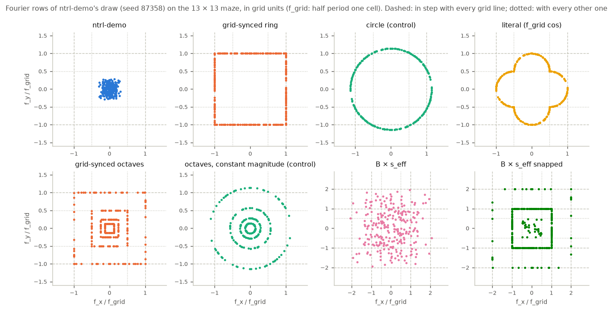

## Setup

**Mazes, data, planner, scoring** are those of `jeffrey/maze_scale` unchanged: the 7×7, 10×10, 13×13 and 22×22 mazes
(prepare runs `20261101T192446Z-9b1569db`, `20261102T032150Z-b0baa8e9`, `20261101T192504Z-13cf1d04`,
`20261101T193403Z-cea05796`), a 0.5 × 0.2-cell rectangle robot in SE(2), ntrl-demo's own training pairs, 40 certified
queries per travel-distance bin, ntrl-demo's MPPI scaled per cell, planning seeds 0/1/2, exact full-footprint scorer.
The ntrl-demo network, losses, optimizer, 5,000 epochs and the training seed's network initialization are unchanged:
the only change is the Fourier matrix B the network embeds its input with.

**ntrl-demo's embedding.** A configuration q = (x, y, φ) (x, y ∈ [−0.5, 0.5]; φ = 0.25 θ / E) enters as
[sin 2π Bq, cos 2π Bq], B (128 × 3) ~ N(0, 1) truncated at ±2. Each row is a plane wave with frequency vector
(f_x, f_y, f_φ) in cycles per normalized unit. The cell pitch is p = 1/E (E = n + 0.1), so the **grid frequency**
f_grid = 1/(2p) = E/2 is the frequency whose half period is exactly one cell. ntrl-demo's rows reach at most
0.56 / 0.39 / 0.30 / 0.18 f_grid on the 7 / 10 / 13 / 22 mazes (largest row of training seed 87358's draw): beyond 7×7
no input feature changes sign within a cell.

**Grid sync with direction.** Take a row with xy direction at angle θ′ to the nearest grid axis (0 ≤ θ′ ≤ 45°). Its
crests are lines perpendicular to that direction. Measured along its own direction they are λ/2 apart (half period);
measured along the grid axis they are λ/(2 cos θ′) apart, the hypotenuse of the right triangle whose leg is λ/2. For
every grid line to see the same phase (one cell = half a period along the axis, so a one-cell shift flips the feature's
sign), the hypotenuse must be one cell: λ/2 = p cos θ′, i.e. |f_xy| = f_grid / cos θ′. In the frequency plane these rows
sit on the square max(|f_x|, |f_y|) = f_grid. Read literally, "half period = grid size / cos θ" is the other right
triangle: λ/2 = p / cos θ′, |f_xy| = f_grid cos θ′. That wave is half a period per grid crossing for a traveller moving
along the wave's own direction, but across the grid a one-cell shift moves its phase by π cos²θ′, so the grid lines do
not all see the same phase (except at θ′ = 0). Both were run.

**Modes** (`features.py`; every mode keeps the directions and the φ column of the same seeded draw, so the network
init is identical; s_eff = f_grid / median row max(|f_x|, |f_y|) ≈ E / 1.9):

| mode | xy frequencies | in sync with the grid? |
|---|---|---|
| `ring` (the method) | \|f_xy\| = f_grid / cos θ′ (square) | every row, exactly (rows at 0° and 45° with both line families) |
| `circle` (control) | \|f_xy\| = c f_grid, c = mean of 1 / cos θ′ (1.14) | only where c cos θ′ = 1; median phase drift across the maze 2–7 rad |
| `literal` | \|f_xy\| = f_grid cos θ′ | only at θ′ = 0 |
| `octaveperm` (control) | the octave rows with their magnitudes shuffled within each octave (fixed permutation) | no (same magnitudes and directions as `octave`) |
| `octave` | rows sorted by ntrl-demo's \|f\|, K equal groups on the squares max(\|f_x\|, \|f_y\|) = f_grid / L, L = 2^(K−1) … 2, 1 (largest power of two ≤ n) | every row, with every L-th grid line |
| `octavecircle` (control) | the same octaves at constant magnitude 1.14 f_grid / L | no |

`features.py` also defines `scaled` (B × s_eff), `snap` (B × s_eff with the upper rows on grid harmonics) and
`ringhalf` / `circlehalf` (half ntrl-demo rows, half ring / circle rows). They were queued as further variants and
dropped unrun once the octaves answered the same questions; the GPU was shared with another study.

`octave` is the multi-scale version of the ring, added after the pure ring collapsed on 22×22 (a spectrum at the grid
frequency only has nothing to build the maze-scale part of T from); `octavecircle` is its control. φ column: × s_eff in every mode (s_eff ∝ E and φ ∝ 1/E, so the heading frequencies per radian are the same on every
maze). `circle` has the ring's mean frequency and the same directions, so `ring` vs `circle` isolates the direction
correction (sync) for a single frequency; `octave` vs `octaveperm` isolates the lock with everything else identical.

