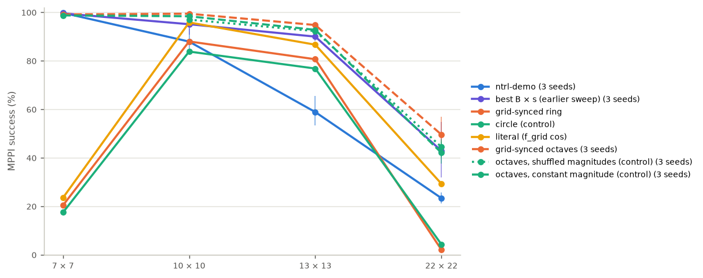

# Grid-synced Fourier features for ntrl-demo

Request (2026-11-02): test resonance with the grid. Make ntrl-demo's Fourier frequencies run in step with the n × n
grid, one cell being half a period; for a wave heading in a direction θ, scale its frequency with the direction ("half
the period would be grid size / cos θ ... cos θ = hyp / grid size"). See whether it makes the field more accurate, and
compare it with the ntrl-demo baseline for a few grid sizes.

Everything below is from registered runs (run ids in `report/tables.md` and on the findings page). Success = ntrl-demo's
MPPI over planning seeds 0/1/2, pooled over training seeds 87358/1/2 where a field has them (otherwise training seed
87358). Findings page: https://claude.ai/artifact/24TwpVguu8HWzgPoLumDBm (built by `page.py`; republish `report/grid_sync.html` with `freq.png`, `speed.png`, `profile.png`).

## Summary

1. **ntrl-demo's own features cannot resolve a cell beyond its demo maze.** Its Fourier rows reach at most 0.56, 0.39,
   0.30 and 0.18 of the grid frequency (half period = one cell) on the 7, 10, 13 and 22-cell mazes. ntrl-demo solves
   {{succ:ntrl-demo:7}}, {{succ:ntrl-demo:10}}, {{succ:ntrl-demo:13}} and {{succ:ntrl-demo:22}} of the runs.
2. **The idea as stated, every feature at the grid frequency with |f| = f_grid / cos θ′ (the `ring`), draws walls
   sharply but is erratic at the maze scale.** On 10×10 and 13×13 it solves {{succ:ring:10}} and {{succ:ring:13}} of the
   runs (ntrl-demo with the same training seed: 83 % and 58 %), with the sharpest walls of any field there (near-wall
   slope {{slope:ring:10}} and {{slope:ring:13}} against {{slope:ntrl-demo:10}} and {{slope:ntrl-demo:13}}; target 1).
   On 7×7 ({{succ:ring:7}}) and 22×22 ({{succ:ring:22}}) its long-range travel time collapses: a spectrum with only
   cell-scale waves has nothing direct to build maze-scale distances from, the learned T stops growing after a few cells
   (7×7: T/T* 0.27 over all queries, 0.12 at 8–16 cells, although its local speed fit is the best of any field, 0.97),
   and the field is full of local minima ({{bumps:ring:7}} and {{bumps:ring:22}} per long true path; on 22×22 the minima
   sit at the cell centres). The circle control (same directions and mean frequency, no 1/cos θ′ correction) behaves
   the same: {{succ:circle:7}}, {{succ:circle:10}}, {{succ:circle:13}}, {{succ:circle:22}}.
3. **Grid-synced octaves fix that and beat ntrl-demo and every frequency scale of the earlier sweep.** Splitting the
   rows into octaves with half periods of 1, 2, 4, … cells, each row in step with every L-th grid line by the same
   1/cos θ′ rule (`octave`), gives {{succ:octave:10}} on 10×10, {{succ:octave:13}} on 13×13 and {{succ:octave:22}} on
   22×22, against ntrl-demo's {{succ:ntrl-demo:10}}, {{succ:ntrl-demo:13}} and {{succ:ntrl-demo:22}} and the best
   hand-tuned frequency scale of the earlier sweep ({{succ:best B × s:10}}, {{succ:best B × s:13}},
   {{succ:best B × s:22}}), with no scale to tune: the grid sets it on every maze. On 7×7 it matches ntrl-demo
   ({{succ:octave:7}} against {{succ:ntrl-demo:7}}, one training seed). The field is also the most accurate one (median
   |log T/T*| {{err:octave:13}} on 13×13 and {{err:octave:22}} on 22×22 against {{err:ntrl-demo:13}} and
   {{err:ntrl-demo:22}}; held-out speed fit {{fit:octave:22}} against {{fit:ntrl-demo:22}} on 22×22), except for the
   longest 22×22 trips, where ntrl-demo's smooth field estimates T better but plans none of them. For scale: the
   midpoint loss of `jeffrey/midpoint_dp` (a training change, same mazes and queries) reached 98 / 91 / 38 % on
   10 / 13 / 22 cells alone and 99 / 94 / 59 % on top of B × 3 / 3 / 6; the two were not combined here.
4. **The grid lock itself adds a little.** The same octaves with each row's magnitude shuffled within its octave (same
   magnitudes, same directions, no longer in step; `octaveperm`) and at constant magnitude (`octavecircle`) isolate it.
   Paired by training seed (same draw and network initialization; table "The lock" below), the synced octaves win
   {{wins:octaveperm:13}} seeds on 13×13 ({{lock:octaveperm:13}} points) and {{wins:octaveperm:22}} on 22×22
   ({{lock:octaveperm:22}} points) against the shuffled control, {{wins:octavecircle:13}} and {{wins:octavecircle:22}}
   ({{lock:octavecircle:13}} and {{lock:octavecircle:22}} points) against the constant one; on 10×10 every octave field
   is near the ceiling and the comparison is mixed ({{lock:octaveperm:10}} and {{lock:octavecircle:10}} points). The
   mechanism is a sharper wall barrier: the synced fields have the higher near-wall slope in every pair measured (22×22,
   seed 87358: {{slope:octave:22}} against {{slope:octaveperm:22}} and {{slope:octavecircle:22}}) and hit fewer walls,
   while their local-minimum counts match the shuffled control's. Most of the gain over ntrl-demo comes from covering
   the cell scale at all, not from the exact lock.
5. **The other reading of the formula**, half period = one cell / cos θ′ (`literal`, |f| = f_grid · cos θ′), is in step
   with the grid crossings only for a traveller moving along the wave, not across the grid. It solves {{succ:literal:7}},
   {{succ:literal:10}}, {{succ:literal:13}} and {{succ:literal:22}} of the runs on the four mazes (seed 87358): better
   than the ring on the large mazes (its rows near 45° fall to half the grid frequency along the axes, a little coarser
   content), far below the octaves.

<!--SETUP-->

## Results

<!--TABLES-->

## Mechanism

<!--MECHANISM-->

**Where the local minima sit.** <!--BUMPPHASE-->

## Caveats

- One maze layout per size (the maze-scale mazes). The lock effect is a few points, measured over 3 (10×10, 13×13) and
  5 (22×22) paired training seeds; the seed spread of a single field on 22×22 is larger than that (B × 6: 229–395 of
  720), which is why it is quoted paired. The octave structure's gain over ntrl-demo is far outside the seed spread.
- The single-frequency `ring`, `circle` and `literal` have one training seed per maze.
- The octave split (equal row counts per octave, rows assigned by ntrl-demo's own frequency order) and the heading
  column scale were set once and not tuned.
- Only the input matrix changes: no loss, data or planner change. The midpoint loss of `jeffrey/midpoint_dp` and segment
  DP were not combined with these features.

## Reproduce

    CUDA_DEVICE_ORDER=PCI_BUS_ID CUDA_VISIBLE_DEVICES=0 ~/.venvs/bellman-ntfield/bin/python jeffrey/grid_sync/run.py \
        --prepared results/registered_20261101T192504Z-13cf1d04 --seed 87358 --mode octave
    ~/.venvs/bellman-ntfield/bin/python jeffrey/grid_sync/report.py
    CUDA_VISIBLE_DEVICES=0 ~/.venvs/bellman-ntfield/bin/python jeffrey/grid_sync/mechanism.py --seeds 87358
    CUDA_VISIBLE_DEVICES=0 ~/.venvs/bellman-ntfield/bin/python jeffrey/grid_sync/bumpphase.py --seeds 87358,1
    CUDA_VISIBLE_DEVICES=0 ~/.venvs/bellman-ntfield/bin/python jeffrey/grid_sync/figs.py
    ~/.venvs/bellman-ntfield/bin/python jeffrey/grid_sync/assemble.py && ~/.venvs/bellman-ntfield/bin/python jeffrey/grid_sync/page.py

Each run executes a frozen copy of `features.py` + `gridsync.py` (`snap/<hash>/`, made by `run.py`; the queue used
release copies v1–v4, identical for every mode they share).
