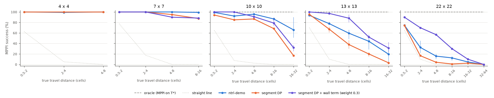
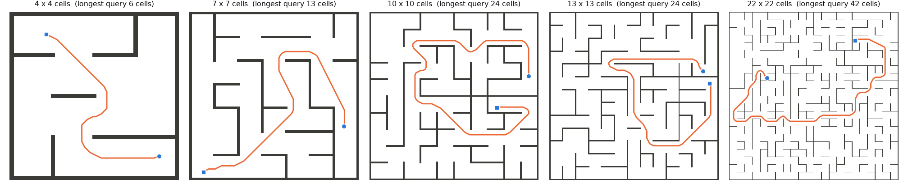
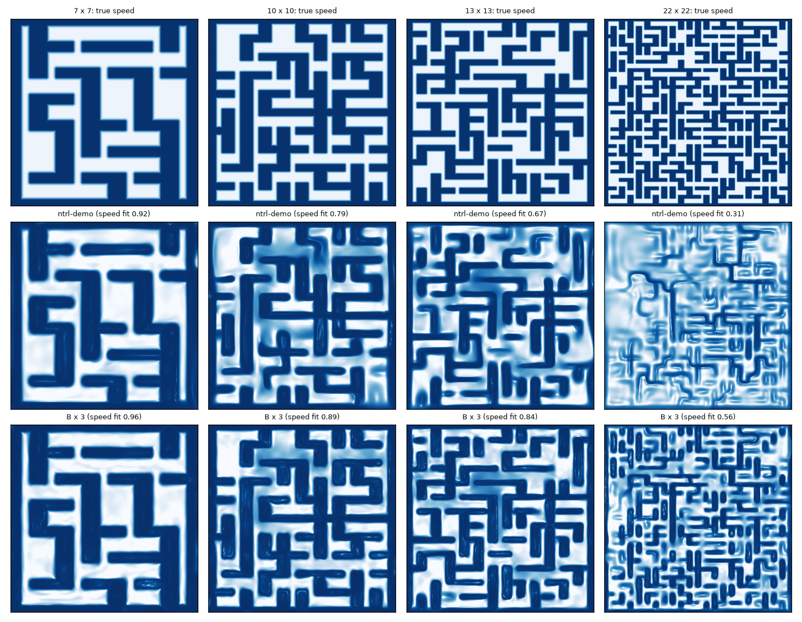

# Maze scale: how ntrl-demo copes with bigger mazes, and whether segment DP helps long trajectories

Request (2026-11-01): test ntrl-demo on small and big environments. Five 2-D mazes, planning in SE(2) with rotation,
mazes as `.obj`; query ntrl-demo with queries binned by distance; then try segment DP and see whether it helps long
trajectories. Follow-ups (2026-11-01/02): replace the 40 × 40 maze by 10 × 10 and drop the zoomed-input control; fewer
DP levels; more split candidates; higher Fourier frequencies; segment DP on a frequency-scaled base; a plus-shaped
opening in the 22 × 22 maze; u-turns around wall ends.

Everything below is from registered runs (run index at the end); success = ntrl-demo's MPPI over planning seeds 0/1/2,
pooled over training seeds 87358/1/2 unless a cell says otherwise. Full tables: `report/tables.md`; near-wall
mechanism: `report/wallfeel.md`; failure geometry: `report/posthoc.md`; follow-ups: `report/extras.md`. Findings page:
https://claude.ai/artifact/JuQxHyTA2siUza9a7ESHRv (built by `page.py`).

## Summary

*MPPI success by true travel distance; ntrl-demo pools training seeds 87358 / 1 / 2 (whisker = seed range), so do
segment DP + wall term (weight 0.3) on 10×10 and 13×13 and plain segment DP on 13×13; every other point is training
seed 87358.*

1. **ntrl-demo is perfect up to the size of its own demo maze and degrades beyond it.** On 4×4 and 7×7 mazes it
   solves 1,077/1,080 and 1,437/1,440 runs. On 10×10 it solves 88 % (1,583/1,800; training seeds 83–93 %), on 13×13
   59 % (1,060/1,800; 53–66 %), on 22×22 23 % (505/2,160). The oracle (the same MPPI on the true travel time) solves
   100 % of every bin of every maze, so the losses are the field's.
2. **Distance matters only once the maze is big, and even short queries suffer there.** At 7×7 success is flat in
   distance. At 13×13 it falls from 94 % (0.5–2 cells) to 19 % (16–32 cells); at 22×22 from 75 % to 0 %. A 2–4-cell
   query is solved 100 % on 7×7, 92 % on 10×10, 78 % on 13×13 and 32 % on 22×22: the field degrades everywhere as the
   maze grows, and long queries add up local errors.
3. **ntrl-demo fails by hitting walls, and the walls fade out of its field.** Planning seed 0, training seed 87358:
   every failed run on 13×13 touches a wall while driving, and 174 of 190 on 22×22 (the other 16 stall, in the two
   longest bins). The learned speed 1/|∇T| matches the true speed less and less (log-correlation on held-out pairs
   0.96, 0.92, 0.81, 0.69, 0.32 from 4 to 22 cells). At near-wall poses (gap 2–8 cells) the field's rise into the wall
   (S·|∇T|, target 1) falls 0.89, 0.86, 0.62, 0.48, 0.24 and its direction (cosine with "into the wall") 0.99, 0.98,
   0.96, 0.92, 0.56.
4. **Control: input frequency explains much of it.** Multiplying ntrl-demo's Fourier matrix B by s (same random draw,
   nothing else changed; `fourier.py`) gives 95 % on 10×10 at s = 3, 90–91 % on 13×13 at s = 3–6 and 43 % on 22×22
   at s = 6 (still rising). Too high a frequency for the maze breaks planning by stalls (7×7 at s = 3: 78 %; 10×10 at
   s = 6: 51 %), although the speed fit keeps rising.
5. **Segment DP as a value chain makes the field better and the planner worse.** Interval DP over geometric gap
   segments (0.5 cells up to the maze diameter, one ntrl-demo network per segment, each fit to min-over-split-point
   targets built from the shorter segments, ntrl-demo's own field below 0.5 cells) fixes the long-range travel times
   (13×13, 16–32 cells: 1.36 × T* vs 2.08) and descent directions, yet plans worse on every maze that is not already
   solved: 13×13 262 / 280 / 263 vs 347 / 320 / 393 of 600 (training seeds 87358 / 1 / 2), 10×10 421 vs 500/600,
   22×22 118 vs 152/720, 7×7 459 vs 480/480 (training seed 87358). Mechanism: the DP levels are fit to values only, so
   they lose the wall barrier that ntrl-demo's near-wall terms give its own field (13×13 near-wall slope 0.24–0.29 vs
   0.41–0.48, direction 0.64–0.73 vs 0.89–0.92), and MPPI collides sooner. Excluding through-wall base pieces from the
   DP (22×22: 132/720) does not change that.
6. **With ntrl-demo's wall term in every DP level, segment DP helps on 13×13 and 22×22.** Fitting ntrl-demo's normal
   (wall-direction) term at near-wall poses in each level (`segdp3.py`) brings the barrier back and the chains stop
   hitting walls: their failures become stalls in local minima of the long-range field. At weight 1 the long-range
   values drift low and long queries stall; at weight 0.3 the chain solves 451 / 456 / 420 of 600 on 13×13 against
   ntrl-demo's 347 / 320 / 393 (74 % vs 59 %), better at every distance (16–32 cells 31 % vs 19 %), and 308 vs 152/720
   on 22×22 (seed 87358). Where ntrl-demo is already good it costs a little: 10×10 504 / 476 / 467 vs 500 / 523 / 560
   (80 % vs 88 %, losing at 16–32 cells: 32 % vs 66 %), 7×7 454 vs 480.
7. **Follow-ups** (section 4): doubling the gap per level does not work (6 networks: 58 %); more split candidates make
   the targets more accurate but planning saturates at 512 (76 %); the DP chain on a frequency-scaled base has more
   accurate values but more local minima and plans worse than either parent (13×13 66 %, 22×22 37 %); opening a
   6-cell + in the 22×22 maze lifts ntrl-demo to 67 % (99 % for queries inside the +); a 2-cell u-turn around a wall
   end degrades with maze size like everything else (ntrl-demo 100 → 3 %), and the scaled DP chain solves it best on
   the large mazes (89 % on 13×13, 73 % on 22×22).

So, for the question: segment DP as a pure value chain does not help long trajectories in these mazes, because a long
trajectory fails by hitting a wall somewhere along the way, which needs a sharp local barrier that value regression does
not keep. With ntrl-demo's own wall term in every level (weight 0.3) it does help where ntrl-demo struggles (74 % vs
59 % on 13×13, 43 % vs 23 % on 22×22). The longest trajectories are then limited by stalls in local minima of the
long-range field, which neither more split candidates nor a higher-frequency base removes; a higher input frequency for
ntrl-demo alone is the larger single gain on 10×10 and 13×13.

## Setup

**Mazes** (`maze.py`). Five square mazes of n = 4, 7, 10, 13 and 22 cells a side (a 40 × 40 maze was run first and
dropped on request, see Dropped runs). Cell pitch 1, walls 0.1 thick on the grid lines. Layout: a perfect
maze (randomized Kruskal), then 15 % of the remaining interior walls removed to open loops, as in ntrl-demo's own demo
maze (`datasets/test/maze`, 7 × 7 cells, open). Every maze is written as an `.obj` (walls extruded to height 0.5) and
normalized exactly as ntrl-demo's `to_off` does (centre on the bounding box, divide by its largest extent n + 0.1), so
the maze fills [−0.5, 0.5]² and a cell is 1/(n + 0.1) of the box: a bigger maze is the same world with more cells,
not a bigger cell.

**Robot and C-space.** A 0.5 × 0.2-cell rectangle with heading θ ∈ [−π/2, π/2] (the rectangle is π-symmetric, so
this holds every orientation; no wrap-around). Configuration q = (x, y, φ) with x, y normalized and φ = 0.25 θ / (n +
0.1): rotating by dθ costs like moving 0.25 dθ cells at every maze size. On a corridor's centre line the robot can turn
in place (half-diagonal 0.27 < 0.45); driving along a corridor broadside leaves 0.2 cells at its ends (slow), aligned
0.35 (fast). Clearance = exact signed distance between the rectangle and the wall boxes (checked against shapely's
polygon distance to 4·10⁻⁶ cells on 20,000 random poses).

**Speed** = ntrl-demo's point recipe clip(d / margin, offset / margin, 1) with margin 0.175 cells (ntrl-demo's
`test`-maze ratio: margin limit/20 = 0.025 at pitch 1/7) and offset margin / 10, stretched by the `metric` trainer to
1.025 s²(2 − s)² − 0.025 (slowest 0.012).

**ntrl-demo** (`data.py`, `train.py`). Its point recipe in the robot's C-space, 500,000 pairs per maze (data seed 0):
x0 within the margin of a wall, x1 = x0 + unit(rand − 0.5) · U(0, √3) not inside a wall, normals = unit C-space
gradient of the clearance. The recipe assumes the unit cube, so it is applied in the cube the C-space box maps to
(φ scaled to [−0.5, 0.5]); applied directly to the thin φ slab every long step would leave the box (median pair gap
0.3 cells at every size). Training = ntrl-demo's `models/metric` package through its own `Model.train()` with
dim = 3, unchanged (5,000 epochs, AdamW 5·10⁻⁴, weight decay 0.5, epoch rollback); training seeds 87358 / 1 / 2.

**Planner** (`plan.py`). ntrl-demo's MPPI (`tests/arm_plan_stat.py`: 50 samples, horizon 5, cost 10 T(first) +
T(last), softmax(−50 cost), stop within tolerance), batched over queries. Its step 0.015 and tolerance 0.01 hold for the
4-cell maze; on a maze with pitch p they are multiplied by p / p₄ and the temperature divided by it (cost differences
between rollouts scale with the step), so the planner is the same in cell units at every size. Step budget per query:
3 × the true path's C-space length / step (at least ntrl-demo's 200). Planning seeds 0 / 1 / 2. A path succeeds if it
reaches the goal and the robot never touches a wall (exact clearance every 0.005 cells).

**Ground truth and queries** (`truth.py`, `prepare.py`). T*(·, goal) on a C-space grid (1/15 cell, 13 headings,
98-neighbourhood shortest paths with the trained speed; within 1 % median / 3 % p99 of a 4× finer grid on the 4- and
7-cell mazes) for 48 goal poses per maze. Queries: 200,000 random start poses (clearance ≥ 0.1 cells) paired with the
goals and binned by the true travel distance D = T* / pitch (cells at full speed): 0.5–2, 2–4, 4–8, … up to the
largest distance the maze has; 40 queries per bin, spread over goals, each certified by its truth path (exact
collision check). Controls: the straight segment, and the *oracle* = the same MPPI driven by T* — 100 % in every bin of
every maze, so every failure below is the learned field's.

## Results

### 1. ntrl-demo by maze size and distance

MPPI success (%), pooled over 3 training seeds × 3 planning seeds (per-seed values in `report/tables.md`):

| maze | field | 0.5-2 | 2-4 | 4-8 | 8-16 | 16-32 | 32-64 | all |
|---|---|---|---|---|---|---|---|---|
| 4×4 | oracle | 100 | 100 | 100 |  |  |  | 100 |
| | straight line | 62 | 5 | 0 |  |  |  | 22 |
| | **ntrl-demo** | **100** | **99** | **100** |  |  |  | **100** |
| 7×7 | oracle | 100 | 100 | 100 | 100 |  |  | 100 |
| | straight line | 78 | 18 | 0 | 0 |  |  | 24 |
| | **ntrl-demo** | **100** | **100** | **100** | **99** |  |  | **100** |
| 10×10 | oracle | 100 | 100 | 100 | 100 | 100 |  | 100 |
| | straight line | 65 | 8 | 2 | 0 | 0 |  | 15 |
| | **ntrl-demo** | **99** | **92** | **96** | **87** | **66** |  | **88** |
| 13×13 | oracle | 100 | 100 | 100 | 100 | 100 |  | 100 |
| | straight line | 70 | 10 | 0 | 0 | 0 |  | 16 |
| | **ntrl-demo** | **94** | **78** | **59** | **44** | **19** |  | **59** |
| 22×22 | oracle | 100 | 100 | 100 | 100 | 100 | 100 | 100 |
| | straight line | 65 | 10 | 0 | 0 | 0 | 0 | 12 |
| | **ntrl-demo** | **75** | **32** | **16** | **12** | **5** | **0** | **23** |

Field diagnostics (median per bin, mean over training seeds; `report/tables.md`): T(start, goal)/T* is 0.91–0.93
at 4×4 and 0.96–1.05 at 7×7, then 1.05–1.80 at 10×10, 1.12–2.08 at 13×13 (the long bins overestimate by 2×) and
1.01–1.43 at 22×22. The cosine between the field's descent direction at the start and the truth's is 0.91–0.97 at 4–7
cells, 0.82–0.95 at 10–13 cells and falls with distance at 22×22, to 0.06 in the longest bin. Spearman correlation of T
with T* over all queries stays 0.97–0.99 at every size: the field orders goals by distance even when it cannot plan to
them.

### 2. Mechanism: the walls fade out

The learned speed 1/|∇_x T(x, goal)| at heading 0 (middle row) redraws every wall of the 7×7 maze, most of the 10×10
and 13×13 walls and a connected subset of the 22×22 walls; the bottom row is ntrl-demo with B × 3. Held-out near-wall
poses (S < 0.3; median S·|∇T| / cosine of ∇T with the into-wall direction, `report/wallfeel.md`):

| maze | field | 0-0.5 | 0.5-2 | 2-8 | >8 |
|---|---|---|---|---|---|
| 4 | ntrl-demo | 0.83 / 0.98 | 0.88 / 0.99 | 0.89 / 0.99 | - |
| 4 | segment DP | 0.83 / 0.98 | 0.81 / 0.99 | 0.81 / 0.99 | - |
| 7 | ntrl-demo | 0.76 / 0.97 | 0.84 / 0.98 | 0.86 / 0.98 | - |
| 7 | segment DP | 0.76 / 0.97 | 0.65 / 0.97 | 0.62 / 0.96 | - |
| 7 | segment DP + wall term | 0.77 / 0.97 | 0.84 / 0.99 | 0.92 / 0.99 | - |
| 7 | segment DP + wall term (weight 0.3) | 0.77 / 0.97 | 0.84 / 0.99 | 0.90 / 0.99 | - |
| 10 | ntrl-demo | 0.51 / 0.92 | 0.57 / 0.95 | 0.62 / 0.96 | 0.57 / 0.95 |
| 10 | segment DP | 0.51 / 0.92 | 0.38 / 0.88 | 0.34 / 0.83 | 0.30 / 0.83 |
| 10 | segment DP + wall term (weight 0.3) | 0.52 / 0.92 | 0.67 / 0.98 | 0.82 / 0.99 | 0.88 / 0.99 |
| 13 | ntrl-demo | 0.38 / 0.86 | 0.41 / 0.89 | 0.48 / 0.92 | 0.48 / 0.91 |
| 13 | segment DP | 0.38 / 0.86 | 0.29 / 0.73 | 0.27 / 0.64 | 0.24 / 0.65 |
| 13 | segment DP + wall term | 0.39 / 0.86 | 0.58 / 0.97 | 0.77 / 0.99 | 0.82 / 0.99 |
| 13 | segment DP + wall term (weight 0.3) | 0.39 / 0.85 | 0.57 / 0.97 | 0.76 / 0.98 | 0.79 / 0.99 |
| 13 | segment DP + wall term (weight 0.3), 2048 split candidates | 0.39 / 0.85 | 0.57 / 0.97 | 0.76 / 0.98 | 0.83 / 0.99 |
| 13 | segment DP + wall term (weight 0.3), 32 split candidates | 0.39 / 0.85 | 0.55 / 0.96 | 0.75 / 0.98 | 0.80 / 0.99 |
| 13 | segment DP + wall term (weight 0.3), 5 levels (ratio 2.000) | 0.39 / 0.85 | 0.53 / 0.95 | 0.67 / 0.97 | 0.70 / 0.97 |
| 13 | segment DP + wall term (weight 0.3), 512 split candidates | 0.39 / 0.85 | 0.56 / 0.97 | 0.74 / 0.98 | 0.80 / 0.99 |
| 13 | segment DP + wall term (weight 0.3), 7 levels (ratio 1.641) | 0.39 / 0.85 | 0.56 / 0.96 | 0.70 / 0.97 | 0.75 / 0.98 |
| 13 | segment DP + wall term (weight 0.3), 9 levels (ratio 1.470) | 0.39 / 0.86 | 0.57 / 0.96 | 0.73 / 0.98 | 0.78 / 0.99 |
| 13 | segment DP + wall term (weight 0.3), B × 3 base | 0.60 / 0.94 | 0.71 / 0.98 | 0.87 / 0.98 | 0.93 / 0.99 |
| 22 | ntrl-demo | 0.21 / 0.57 | 0.23 / 0.35 | 0.24 / 0.56 | 0.24 / 0.64 |
| 22 | segment DP | 0.21 / 0.57 | 0.23 / 0.19 | 0.23 / 0.20 | 0.22 / 0.25 |
| 22 | segment DP + wall term | 0.22 / 0.58 | 0.47 / 0.96 | 0.60 / 0.97 | 0.60 / 0.98 |
| 22 | segment DP + wall term (weight 0.3) | 0.21 / 0.57 | 0.35 / 0.89 | 0.57 / 0.96 | 0.61 / 0.97 |
| 22 | segment DP + wall term (weight 0.3), B × 6 base | 0.45 / 0.82 | 0.61 / 0.95 | 0.75 / 0.96 | 0.78 / 0.97 |
| 22 | segment DP, checked pieces | 0.21 / 0.57 | 0.24 / 0.17 | 0.23 / 0.17 | 0.22 / 0.24 |

Failure geometry (`report/posthoc.md`, planning seed 0, training seed 87358; the goal the scorer appends to a run
that never converged is excluded): on 22×22 the first wall contact comes after a median 0.4–0.7 cells for queries up to
4 cells and 1.1–3.5 cells for longer ones; on 13×13 after 0.8–4.3 cells (22–51 % of the route).

### 3. Segment DP

`segdp.py`: the interval-DP transition of `jeffrey/segment_dp` on maze C-space gaps,
T_(m+1)(i, j) = min_k T_≤m(i, k) + T_≤m(k, j) with |i − k|, |k − j| ≤ e_m (1 + blend). Edges are geometric in cells
(0.5, ×1.35, … to the 99.9th-percentile pool gap; 8 levels at 4×4, 14 at 22×22, blend ±5 %); below 0.5 cells the chain
is ntrl-demo's trained field; each level is an ntrl-demo `metric` network warm-started from the previous level and fit
for 6,000 steps (batch 2,000, AdamW 5·10⁻⁴) with |log T − log y| to the DP targets of 100,000 pool pairs (200,000
collision-free pool poses; 128 split candidates per pair, half nearest the straight line, half uniform in the lens).
The chain is planned with the same MPPI and diagnosed the same way. Variants: `--check-pieces` (a base piece counts
only if its straight segment is collision-free), `segdp3.py` (ntrl-demo's normal term at
near-wall poses paired with goals in each level's segment, weight 1 as `jeffrey/segment_dp` dp3 `--normal-weight`,
and 0.3).

MPPI success (%) by true travel distance, per training seed (3 planning seeds each):

| maze | field (training seed) | 0.5-2 | 2-4 | 4-8 | 8-16 | 16-32 | 32-64 | all |
|---|---|---|---|---|---|---|---|---|
| 4×4 | ntrl-demo (87358) | 100 | 100 | 100 |  |  |  | 100 (360/360) |
|  | segment DP (87358) | 100 | 100 | 100 |  |  |  | 100 (360/360) |
| 7×7 | ntrl-demo (87358) | 100 | 100 | 100 | 100 |  |  | 100 (480/480) |
|  | segment DP (87358) | 100 | 100 | 95 | 88 |  |  | 96 (459/480) |
|  | segment DP + wall term (87358) | 100 | 100 | 91 | 81 |  |  | 93 (446/480) |
|  | segment DP + wall term (weight 0.3) (87358) | 100 | 100 | 90 | 88 |  |  | 95 (454/480) |
| 10×10 | ntrl-demo (87358) | 98 | 88 | 98 | 82 | 51 |  | 83 (500/600) |
|  | ntrl-demo (1) | 100 | 96 | 95 | 88 | 57 |  | 87 (523/600) |
|  | ntrl-demo (2) | 99 | 93 | 95 | 89 | 90 |  | 93 (560/600) |
|  | segment DP (87358) | 94 | 85 | 87 | 68 | 17 |  | 70 (421/600) |
|  | segment DP + wall term (weight 0.3) (87358) | 100 | 100 | 95 | 88 | 37 |  | 84 (504/600) |
|  | segment DP + wall term (weight 0.3) (1) | 100 | 100 | 88 | 75 | 34 |  | 79 (476/600) |
|  | segment DP + wall term (weight 0.3) (2) | 100 | 100 | 91 | 73 | 25 |  | 78 (467/600) |
| 13×13 | ntrl-demo (87358) | 92 | 75 | 48 | 48 | 27 |  | 58 (347/600) |
|  | ntrl-demo (1) | 92 | 78 | 66 | 28 | 3 |  | 53 (320/600) |
|  | ntrl-demo (2) | 98 | 81 | 64 | 57 | 28 |  | 66 (393/600) |
|  | segment DP (87358) | 96 | 61 | 38 | 23 | 1 |  | 44 (262/600) |
|  | segment DP (1) | 95 | 72 | 46 | 15 | 6 |  | 47 (280/600) |
|  | segment DP (2) | 96 | 69 | 30 | 22 | 2 |  | 44 (263/600) |
|  | segment DP + wall term (87358) | 100 | 88 | 82 | 42 | 2 |  | 63 (379/600) |
|  | segment DP + wall term (1) | 100 | 90 | 78 | 38 | 28 |  | 67 (400/600) |
|  | segment DP + wall term (2) | 98 | 91 | 78 | 42 | 5 |  | 63 (377/600) |
|  | segment DP + wall term (weight 0.3) (87358) | 100 | 99 | 95 | 55 | 27 |  | 75 (451/600) |
|  | segment DP + wall term (weight 0.3) (1) | 100 | 98 | 89 | 51 | 42 |  | 76 (456/600) |
|  | segment DP + wall term (weight 0.3) (2) | 100 | 95 | 80 | 51 | 24 |  | 70 (420/600) |
| 22×22 | ntrl-demo (87358) | 75 | 22 | 10 | 15 | 5 | 0 | 21 (152/720) |
|  | segment DP (87358) | 74 | 17 | 4 | 1 | 2 | 0 | 16 (118/720) |
|  | segment DP, checked pieces (87358) | 76 | 21 | 5 | 6 | 2 | 0 | 18 (132/720) |
|  | segment DP + wall term (87358) | 86 | 58 | 41 | 8 | 0 | 0 | 32 (232/720) |
|  | segment DP + wall term (weight 0.3) (87358) | 90 | 70 | 57 | 30 | 10 | 0 | 43 (308/720) |

Per-level truth probes (pool pose → truth goal pairs in each segment): the DP targets track the trained levels to
0.2–3 % (held-out |log|) and sit at 1.07–1.36 × T* on 13×13 and 22×22 (ntrl-demo's own short-range bias, 1.03–1.2,
plus split-point detours), against 1.03–1.96 × for ntrl-demo itself at the same gaps on 13×13.

### 4. Follow-ups

- **Fewer networks** (`--ratio`, 13×13, weight 0.3): r = 2 (6 networks) 58 %, 1.641 (8) 60 %, 1.470 (10) 69 %, 1.35
  (13) 74 %. At the top of a band the lens of admissible split points has half-width R√(1 − (r/2)²), zero at r = 2, so
  a detour around a wall has no split point; targets overestimate and compound (top level 1.42 × T* with 6 networks,
  1.11 × with 13).
- **Split candidates** (`--candidates`, 13×13, weight 0.3): 32 → 69 %, 128 → 74 %, 512 → 76 % (three seeds), 2,048 →
  453/600 (seed 87358; 465 at 512). Top-level target / T* 1.22, 1.12, 1.08, 1.04. Failures remain stalls (143 of 147 at
  2,048 never reach the goal).
- **Fourier scale** (`fourier.py`): see summary item 4 and the table below; the over-scaled failures (7×7 s = 3,
  10×10 s = 6) are all stalls.
- **Segment DP on the scaled base** (`segdp3.py --base` a `fourier.py` checkpoint; every level inherits the scaled B):
  13×13 B × 3 66 % (394 / 378 / 416) vs 74 % plain-base chain and 90 % ntrl-demo B × 3; 22×22 B × 6 37 % (263 / 256 /
  282 of 720) vs 43 % for both. Its values are more accurate (13×13 top target 1.07 × T* vs 1.11–1.14; near-wall slope
  0.87–0.93 vs 0.75–0.82) but it has more local minima of T(x, goal) along true paths of ≥ 8 cells (13×13: 5.6–7.6 per
  path vs 3.4–4.7 for the plain-base chain and 0–0.1 for ntrl-demo; 22×22: 11–13 vs 6.7 and 0.3–1.9), not
  concentrated in blend zones (33 % of minima in 32 % of path length). The DP levels are fit to values only, so
  nothing constrains the gradient between samples; a higher-frequency embedding turns the residual error into short
  ripples, and MPPI stalls in them. ntrl-demo's eikonal loss constrains |∇T| and keeps its field monotone at these
  scales.
- **Plus maze** (`plusprepare.py`, `plusntrl.py`; `plus.py` patches the maze generator in-process): a centred + of
  width 6 cells, interior walls removed (168 of 458; 228 of 484 cells). ntrl-demo 67 % (468 / 479 / 490 of 720) vs
  23 % on the original maze; speed fit 0.53 vs 0.32. Both ends inside the + 99 %, one end 45 %, neither 18 % (mostly
  32–64-cell queries, 0 % for every field). The straight line also gains (49 % vs 13 %), but ntrl-demo's margin over
  it grows too (15–34 vs 5–22 points per bin from 2 to 32 cells).
- **U-turns** (`uturn.py`, `uturneval.py`): start and goal in the two cells beside a wall's last segment (1 cell apart,
  path round the end 2.2–2.3 cells), 40 per maze. ntrl-demo 100 / 99 / 83 / 30 / 3 % on 4 / 7 / 10 / 13 / 22 cells,
  mostly by cutting through the wall end; B × 3 96 % (10×10), 81 % (13×13); DP + wall term 97 / 79 / 29 %; DP on the
  scaled base 89 % (13×13, B × 3) and 73 % (22×22, B × 6).
- **Level viewer** (`levelexplorer.py` → `report/levelexplorer/`, artifact https://claude.ai/artifact/XunBq8wPMFfm2LPgk9jwbs;
  static version `levelfields.py`): the travel-time field of each chain level on 13×13 and 22×22 next to the truth,
  for one query per level band.

**Fewer networks (13 × 13, segment DP + wall term weight 0.3, same ntrl-demo base per seed)**

| networks | edge ratio | runs solved per seed (87358 / 1 / 2, of 600) | all | 0.5-2 cells | 2-4 cells | 4-8 cells | 8-16 cells | 16-32 cells | T/T* 16–32 | minutes per seed |
|---|---|---|---|---|---|---|---|---|---|---|
| 1 | – | 347 / 320 / 393 | 59 % (1060/1800) | 94 | 78 | 59 | 44 | 19 | 2.08 | – |
| 6 | 2.000 | 346 / 354 / 338 | 58 % (1038/1800) | 100 | 94 | 77 | 17 | 1 | 1.59 | 8 / 8 / 10 |
| 8 | 1.641 | 399 / 309 / 366 | 60 % (1074/1800) | 99 | 96 | 77 | 22 | 4 | 1.25 | 25 / 14 / 17 |
| 10 | 1.470 | 420 / 418 / 399 | 69 % (1237/1800) | 100 | 97 | 85 | 44 | 19 | 1.22 | 19 / 20 / 19 |
| 13 | 1.350 | 451 / 456 / 420 | 74 % (1327/1800) | 100 | 97 | 88 | 52 | 31 | 1.16 | 19 / 19 / 20 |

**Split candidates per DP pair (13 × 13, segment DP + wall term weight 0.3, 13 networks)**

| candidates | runs solved per seed (87358 / 1 / 2, of 600) | all | 0.5-2 cells | 2-4 cells | 4-8 cells | 8-16 cells | 16-32 cells | top-level target / T* | target minutes | minutes per run |
|---|---|---|---|---|---|---|---|---|---|---|
| 32 | 440 / 400 / 397 | 69 % (1237/1800) | 99 | 97 | 85 | 43 | 19 | 1.222 | 5 | 35 / 18 / 19 |
| 128 | 451 / 456 / 420 | 74 % (1327/1800) | 100 | 97 | 88 | 52 | 31 | 1.124 | 6 | 19 / 19 / 20 |
| 512 | 465 / 461 / 442 | 76 % (1368/1800) | 100 | 98 | 89 | 56 | 38 | 1.081 | 21 | 41 / 55 / 30 |
| 2048 | 453 | 76 % (453/600) | 100 | 98 | 90 | 51 | 39 | 1.037 | 58 | 71 |

**Segment DP + wall term (weight 0.3) on the B × 6 base, 22 × 22**

| field | runs solved per seed (87358 / 1 / 2) | all | 0.5-2 cells | 2-4 cells | 4-8 cells | 8-16 cells | 16-32 cells | 32-64 cells |
|---|---|---|---|---|---|---|---|---|
| ntrl-demo | 152 / 186 / 167 (of 720) | 23 % (505/2160) | 75 | 32 | 16 | 12 | 5 | 0 |
| ntrl-demo, B × 6 | 302 / 229 / 395 (of 720) | 43 % (926/2160) | 86 | 64 | 42 | 35 | 22 | 8 |
| segment DP + wall term (weight 0.3) | 308 (of 720) | 43 % (308/720) | 90 | 70 | 57 | 30 | 10 | 0 |
| segment DP + wall term (weight 0.3) on the B × 6 base | 263 / 256 / 282 (of 720) | 37 % (801/2160) | 98 | 82 | 35 | 6 | 1 | 0 |

**Segment DP + wall term (weight 0.3) on the B × 3 base, 13 × 13**

| field | runs solved per seed (87358 / 1 / 2) | all | 0.5-2 cells | 2-4 cells | 4-8 cells | 8-16 cells | 16-32 cells |
|---|---|---|---|---|---|---|---|
| ntrl-demo | 347 / 320 / 393 (of 600) | 59 % (1060/1800) | 94 | 78 | 59 | 44 | 19 |
| ntrl-demo, B × 3 | 554 / 529 / 537 (of 600) | 90 % (1620/1800) | 99 | 97 | 89 | 91 | 75 |
| segment DP + wall term (weight 0.3) | 451 / 456 / 420 (of 600) | 74 % (1327/1800) | 100 | 97 | 88 | 52 | 31 |
| segment DP + wall term (weight 0.3) on the B × 3 base | 394 / 378 / 416 (of 600) | 66 % (1188/1800) | 100 | 95 | 79 | 39 | 17 |

**Plus maze: 22 × 22 with a 6-cell + opened (228 of 484 cells, 168 walls removed; prepare run 20261102T042454Z-62864e61)**

| field | runs solved per seed (87358 / 1 / 2) | all | 0.5-2 cells | 2-4 cells | 4-8 cells | 8-16 cells | 16-32 cells | 32-64 cells | speed fit |
|---|---|---|---|---|---|---|---|---|---|
| oracle on the plus maze | – | – | 100 | 100 | 100 | 100 | 100 | 100 | – |
| straight line on the plus maze | – | – | 95 | 82 | 68 | 38 | 12 | 0 | – |
| ntrl-demo, original 22 × 22 | 152 / 186 / 167 (of 720) | 23 % (505/2160) | 75 | 32 | 16 | 12 | 5 | 0 | 0.32 |
| ntrl-demo, plus maze | 468 / 479 / 490 (of 720) | 67 % (1437/2160) | 100 | 98 | 89 | 71 | 41 | 0 | 0.53 |

Plus maze by where the query ends lie (runs solved): neither in the + 80/441 (18 %, 49 queries), one end 294/648 (45 %, 72 queries), both ends 1063/1071 (99 %, 119 queries)

**Fourier scale (ntrl-demo with B × s, same seed draw; s = 1 is plain ntrl-demo)**

| maze | B scale | runs solved per seed (87358 / 1 / 2) | all | speed fit |
|---|---|---|---|---|
| 7×7 | 1 | 480 / 480 / 477 (of 480) | 100 % (1437/1440) | 0.91 |
| 7×7 | 1.5 | 477 / 480 / 477 (of 480) | 100 % (1434/1440) | 0.93 |
| 7×7 | 3 | 391 / 345 / 381 (of 480) | 78 % (1117/1440) | 0.96 |
| 10×10 | 1 | 500 / 523 / 560 (of 600) | 88 % (1583/1800) | 0.81 |
| 10×10 | 1.5 | 513 / 581 / 585 (of 600) | 93 % (1679/1800) | 0.85 |
| 10×10 | 3 | 592 / 575 / 545 (of 600) | 95 % (1712/1800) | 0.90 |
| 10×10 | 6 | 304 (of 600) | 51 % (304/600) | 0.93 |
| 13×13 | 1 | 347 / 320 / 393 (of 600) | 59 % (1060/1800) | 0.69 |
| 13×13 | 1.5 | 441 / 450 / 473 (of 600) | 76 % (1364/1800) | 0.75 |
| 13×13 | 3 | 554 / 529 / 537 (of 600) | 90 % (1620/1800) | 0.84 |
| 13×13 | 6 | 548 (of 600) | 91 % (548/600) | 0.89 |
| 22×22 | 1 | 152 / 186 / 167 (of 720) | 23 % (505/2160) | 0.32 |
| 22×22 | 1.5 | 159 / 179 / 175 (of 720) | 24 % (513/2160) | 0.39 |
| 22×22 | 3 | 212 / 175 / 201 (of 720) | 27 % (588/2160) | 0.52 |
| 22×22 | 6 | 302 / 229 / 395 (of 720) | 43 % (926/2160) | 0.66 |

**U-turns around a wall end (40 queries per maze × 3 planning seeds per training seed)**

| maze | field | runs solved per seed (87358 / 1 / 2, of 120) | all |
|---|---|---|---|
| 4×4 | oracle (MPPI on T*) | – | 100 % (120/120) |
| | straight line | – | 0 % (0/40) |
| | ntrl-demo | 120 / 120 / 120 | 100 % (360/360) |
| | segment DP | 120 | 100 % (120/120) |
| 7×7 | oracle (MPPI on T*) | – | 100 % (120/120) |
| | straight line | – | 0 % (0/40) |
| | ntrl-demo | 118 / 120 / 119 | 99 % (357/360) |
| | segment DP | 116 | 97 % (116/120) |
| | segment DP + wall term | 115 | 96 % (115/120) |
| | segment DP + wall term (weight 0.3) | 120 | 100 % (120/120) |
| | ntrl-demo, B × 1.5 | 120 / 120 / 120 | 100 % (360/360) |
| | ntrl-demo, B × 3 | 120 / 120 / 120 | 100 % (360/360) |
| 10×10 | oracle (MPPI on T*) | – | 100 % (120/120) |
| | straight line | – | 0 % (0/40) |
| | ntrl-demo | 87 / 117 / 95 | 83 % (299/360) |
| | segment DP | 63 | 52 % (63/120) |
| | ntrl-demo, B × 1.5 | 113 / 111 / 113 | 94 % (337/360) |
| | segment DP + wall term (weight 0.3) | 113 / 117 / 120 | 97 % (350/360) |
| | ntrl-demo, B × 3 | 113 / 115 / 119 | 96 % (347/360) |
| | ntrl-demo, B × 6 | 105 | 88 % (105/120) |
| 13×13 | oracle (MPPI on T*) | – | 100 % (120/120) |
| | straight line | – | 0 % (0/40) |
| | ntrl-demo | 24 / 39 / 45 | 30 % (108/360) |
| | segment DP | 13 / 18 / 9 | 11 % (40/360) |
| | segment DP + wall term | 73 / 90 / 68 | 64 % (231/360) |
| | segment DP + wall term (weight 0.3) | 99 / 89 / 96 | 79 % (284/360) |
| | segment DP + wall term (weight 0.3), 5 levels (ratio 2.000) | 78 / 85 / 85 | 69 % (248/360) |
| | segment DP + wall term (weight 0.3), 7 levels (ratio 1.641) | 102 / 96 / 94 | 81 % (292/360) |
| | ntrl-demo, B × 1.5 | 62 / 72 / 72 | 57 % (206/360) |
| | ntrl-demo, B × 3 | 93 / 112 / 85 | 81 % (290/360) |
| | segment DP + wall term (weight 0.3), 9 levels (ratio 1.470) | 98 / 96 / 83 | 77 % (277/360) |
| | ntrl-demo, B × 6 | 109 | 91 % (109/120) |
| | segment DP + wall term (weight 0.3), 32 split candidates | 89 / 87 / 94 | 75 % (270/360) |
| | segment DP + wall term (weight 0.3), 512 split candidates | 97 / 89 / 99 | 79 % (285/360) |
| | segment DP + wall term (weight 0.3), B × 3 base | 107 / 111 / 104 | 89 % (322/360) |
| | segment DP + wall term (weight 0.3), 2048 split candidates | 99 | 82 % (99/120) |
| 22×22 | oracle (MPPI on T*) | – | 100 % (120/120) |
| | straight line | – | 0 % (0/40) |
| | ntrl-demo | 4 / 3 / 3 | 3 % (10/360) |
| | segment DP | 0 | 0 % (0/120) |
| | segment DP, checked pieces | 0 | 0 % (0/120) |
| | segment DP + wall term | 44 | 37 % (44/120) |
| | segment DP + wall term (weight 0.3) | 35 | 29 % (35/120) |
| | ntrl-demo, B × 1.5 | 0 / 12 / 9 | 6 % (21/360) |
| | ntrl-demo, B × 3 | 5 / 3 / 10 | 5 % (18/360) |
| | ntrl-demo, B × 6 | 32 / 12 / 48 | 26 % (92/360) |
| | segment DP + wall term (weight 0.3), B × 6 base | 91 / 86 / 84 | 72 % (261/360) |

## Caveats

- ntrl-demo has three training seeds on every maze; segment DP + wall term (weight 0.3) on 10×10 and 13×13, plain
  segment DP and weight 1 on 13×13, and the 13×13 follow-up variants (unless their table says otherwise) have three;
  every other DP number is training seed 87358 only. ntrl-demo's 13×13 seeds differ by up to 73 runs of 600 (320–393), mostly in the
  long bins, so single-seed differences smaller than that are not separations (the 22×22 wall-term gain,
  +156, is larger than the seed spread there: 152–186).
- The wall-term weight was tried at 1 and 0.3 only, on 13×13 first (one seed) and then carried to the other mazes.
- One maze per size (seed 1000 + n); a different layout of the same size would move the numbers.
- 40 queries per distance bin; bins a maze cannot reach are absent (4×4 reaches 4–8 cells, 22×22 32–64).
- The planner is ntrl-demo's MPPI scaled per cell; a gradient-descent planner or a wider MPPI was not tried here.
- ntrl-demo's `metric` package was run unchanged except for the data recipe being applied in the unit cube the
  C-space box maps to (see Setup); its TD step (0.03 of the box) spans 0.7 cells at 22×22.

## Reproduce

    CUDA_DEVICE_ORDER=PCI_BUS_ID CUDA_VISIBLE_DEVICES=1 ~/.venvs/bellman-ntfield/bin/python jeffrey/maze_scale/run.py prepare --n 13
    CUDA_DEVICE_ORDER=PCI_BUS_ID CUDA_VISIBLE_DEVICES=1 ~/.venvs/bellman-ntfield/bin/python jeffrey/maze_scale/run.py ntrl --prepared results/registered_<prepare id> --seed 87358
    CUDA_DEVICE_ORDER=PCI_BUS_ID CUDA_VISIBLE_DEVICES=1 ~/.venvs/bellman-ntfield/bin/python jeffrey/maze_scale/run.py fourier --prepared ... --seed 87358 --b-scale 3.0
    CUDA_DEVICE_ORDER=PCI_BUS_ID CUDA_VISIBLE_DEVICES=1 ~/.venvs/bellman-ntfield/bin/python jeffrey/maze_scale/run.py segdp --prepared ... --base results/registered_<ntrl id>/training/checkpoint.pt --seed 87358
    CUDA_DEVICE_ORDER=PCI_BUS_ID CUDA_VISIBLE_DEVICES=1 ~/.venvs/bellman-ntfield/bin/python jeffrey/maze_scale/run.py segdp3 --prepared ... --base ... --seed 87358
    ~/.venvs/bellman-ntfield/bin/python jeffrey/maze_scale/report.py
    CUDA_VISIBLE_DEVICES=0 ~/.venvs/bellman-ntfield/bin/python jeffrey/maze_scale/wallfeel.py
    CUDA_VISIBLE_DEVICES=0 ~/.venvs/bellman-ntfield/bin/python jeffrey/maze_scale/posthoc.py
    CUDA_VISIBLE_DEVICES=0 ~/.venvs/bellman-ntfield/bin/python jeffrey/maze_scale/figs.py
    ~/.venvs/bellman-ntfield/bin/python jeffrey/maze_scale/extras.py
    ~/.venvs/bellman-ntfield/bin/python jeffrey/maze_scale/assemble.py
    ~/.venvs/bellman-ntfield/bin/python jeffrey/maze_scale/explorer/fragment.py && ~/.venvs/bellman-ntfield/bin/python jeffrey/maze_scale/page.py

Superseded: the first four prepare runs (20261101T192118Z-57dea88a, -645cf7ff, 192127Z-848660ef, 192138Z-d3554001) had
a truth-seeding bug (fixed in `truth.py`; registry notes). Cancelled: 20261101T204642Z-c422c40e (DP on the zoomed 40×40
base, stopped at level 1 because that base was as wall-blind as the default).

Dropped runs (on request, 2026-11-01): the 40×40 maze (replaced by 10×10) and the zoomed-input control (`zoom.py`,
`segdp2.py`). Their registered runs stay on disk and `report.py` skips them (`DROPPED_N`, `DROPPED_STAGES`). Earlier
results: ntrl-demo 268/2,520 on 40×40 (= the straight line), DP + wall term 155/840; zoom 13×13 444/600, 22×22
213/720, 40×40 108/840.

## Run index

| maze | stage | training seed | run id (results/registered_&lt;id&gt;) |
|---|---|---|---|
| 4×4 | prepare | - | 20261101T192432Z-423319dc |
| | ntrl-demo | 1 | 20261101T194708Z-15deb708 |
| | ntrl-demo | 2 | 20261101T195648Z-927151d4 |
| | ntrl-demo | 87358 | 20261101T193251Z-f43026ee |
| | segment DP | 87358 | 20261101T203439Z-6ed89e28 |
| 7×7 | prepare | - | 20261101T192446Z-9b1569db |
| | ntrl-demo | 1 | 20261101T201244Z-1ae74c20 |
| | ntrl-demo | 2 | 20261101T202527Z-32f7835e |
| | ntrl-demo | 87358 | 20261101T200440Z-b920137d |
| | segment DP | 87358 | 20261101T201621Z-4d135bc3 |
| | segment DP + wall term | 87358 | 20261101T212502Z-d09fb16b |
| | segment DP + wall term (weight 0.3) | 87358 | 20261101T230634Z-024a6522 |
| 10×10 | prepare | - | 20261102T032150Z-b0baa8e9 |
| | ntrl-demo | 1 | 20261102T033305Z-5d802f80 |
| | ntrl-demo | 2 | 20261102T032238Z-09a41392 |
| | ntrl-demo | 87358 | 20261102T032216Z-e76476bf |
| | segment DP | 87358 | 20261102T033401Z-dec4726c |
| | segment DP + wall term (weight 0.3) | 1 | 20261102T042037Z-5a6a9ec6 |
| | segment DP + wall term (weight 0.3) | 2 | 20261102T043331Z-50fe7ef2 |
| | segment DP + wall term (weight 0.3) | 87358 | 20261102T035422Z-06108e12 |
| 13×13 | prepare | - | 20261101T192504Z-13cf1d04 |
| | ntrl-demo | 1 | 20261101T204630Z-58badec5 |
| | ntrl-demo | 2 | 20261101T205900Z-c57aa0f1 |
| | ntrl-demo | 87358 | 20261101T203437Z-ebc95225 |
| | segment DP | 1 | 20261101T221325Z-26a627cd |
| | segment DP | 2 | 20261101T212901Z-f4ac5cd0 |
| | segment DP | 87358 | 20261101T204654Z-6719910c |
| | segment DP + wall term | 1 | 20261101T214011Z-1684e9fd |
| | segment DP + wall term | 2 | 20261101T215413Z-4f22c760 |
| | segment DP + wall term | 87358 | 20261101T210413Z-ae790e10 |
| | segment DP + wall term (weight 0.3) | 1 | 20261101T222804Z-9ddcbd27 |
| | segment DP + wall term (weight 0.3) | 2 | 20261101T224644Z-59272aa7 |
| | segment DP + wall term (weight 0.3) | 87358 | 20261101T215932Z-1bbbfbc7 |
| 22×22 | prepare | - | 20261101T193403Z-cea05796 |
| | ntrl-demo | 1 | 20261101T194908Z-fa2678e3 |
| | ntrl-demo | 2 | 20261101T200614Z-92e8b351 |
| | ntrl-demo | 87358 | 20261101T193703Z-dd44f02b |
| | segment DP | 87358 | 20261101T202506Z-fbbff9fe |
| | segment DP, checked pieces | 87358 | 20261101T204940Z-0ab9e137 |
| | segment DP + wall term | 87358 | 20261101T212214Z-6b29cad2 |
| | segment DP + wall term (weight 0.3) | 87358 | 20261101T223027Z-dd0f1f6b |
