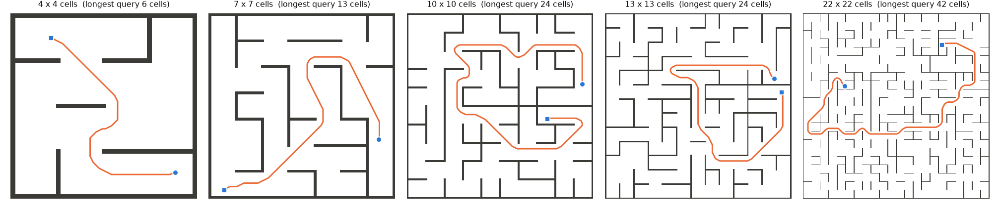

## Setup

**Mazes** (`maze.py`). Five square mazes of n = 4, 7, 10, 13 and 22 cells a side (a 40 × 40 maze was run first and
dropped on request, see Dropped runs). Cell pitch 1, walls 0.1 thick on the grid lines. Layout: a perfect
maze (randomized Kruskal), then 15 % of the remaining interior walls removed to open loops, as in ntrl-demo's own demo
maze (`datasets/test/maze`, 7 × 7 cells, open). Every maze is written as an `.obj` (walls extruded to height 0.5) and
normalized exactly as ntrl-demo's `to_off` does (centre on the bounding box, divide by its largest extent n + 0.1), so
the maze fills [−0.5, 0.5]² and a cell is 1/(n + 0.1) of the box: a bigger maze is the same world with more cells,
not a bigger cell.

**Robot and C-space.** A 0.5 × 0.2-cell rectangle with heading θ ∈ [−π/2, π/2] (the rectangle is π-symmetric, so
this holds every orientation; no wrap-around). Configuration q = (x, y, φ) with x, y normalized and φ = 0.25 θ / (n +
0.1): rotating by dθ costs like moving 0.25 dθ cells at every maze size. On a corridor's centre line the robot can turn
in place (half-diagonal 0.27 < 0.45); driving along a corridor broadside leaves 0.2 cells at its ends (slow), aligned
0.35 (fast). Clearance = exact signed distance between the rectangle and the wall boxes (checked against shapely's
polygon distance to 4·10⁻⁶ cells on 20,000 random poses).

**Speed** = ntrl-demo's point recipe clip(d / margin, offset / margin, 1) with margin 0.175 cells (ntrl-demo's
`test`-maze ratio: margin limit/20 = 0.025 at pitch 1/7) and offset margin / 10, stretched by the `metric` trainer to
1.025 s²(2 − s)² − 0.025 (slowest 0.012).

**ntrl-demo** (`data.py`, `train.py`). Its point recipe in the robot's C-space, 500,000 pairs per maze (data seed 0):
x0 within the margin of a wall, x1 = x0 + unit(rand − 0.5) · U(0, √3) not inside a wall, normals = unit C-space
gradient of the clearance. The recipe assumes the unit cube, so it is applied in the cube the C-space box maps to
(φ scaled to [−0.5, 0.5]); applied directly to the thin φ slab every long step would leave the box (median pair gap
0.3 cells at every size). Training = ntrl-demo's `models/metric` package through its own `Model.train()` with
dim = 3, unchanged (5,000 epochs, AdamW 5·10⁻⁴, weight decay 0.5, epoch rollback); training seeds 87358 / 1 / 2.

**Planner** (`plan.py`). ntrl-demo's MPPI (`tests/arm_plan_stat.py`: 50 samples, horizon 5, cost 10 T(first) +
T(last), softmax(−50 cost), stop within tolerance), batched over queries. Its step 0.015 and tolerance 0.01 hold for the
4-cell maze; on a maze with pitch p they are multiplied by p / p₄ and the temperature divided by it (cost differences
between rollouts scale with the step), so the planner is the same in cell units at every size. Step budget per query:
3 × the true path's C-space length / step (at least ntrl-demo's 200). Planning seeds 0 / 1 / 2. A path succeeds if it
reaches the goal and the robot never touches a wall (exact clearance every 0.005 cells).

**Ground truth and queries** (`truth.py`, `prepare.py`). T*(·, goal) on a C-space grid (1/15 cell, 13 headings,
98-neighbourhood shortest paths with the trained speed; within 1 % median / 3 % p99 of a 4× finer grid on the 4- and
7-cell mazes) for 48 goal poses per maze. Queries: 200,000 random start poses (clearance ≥ 0.1 cells) paired with the
goals and binned by the true travel distance D = T* / pitch (cells at full speed): 0.5–2, 2–4, 4–8, … up to the
largest distance the maze has; 40 queries per bin, spread over goals, each certified by its truth path (exact
collision check). Controls: the straight segment, and the *oracle* = the same MPPI driven by T* — 100 % in every bin of
every maze, so every failure below is the learned field's.
