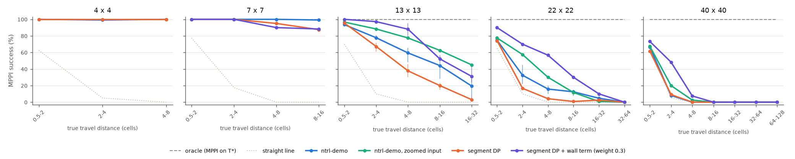
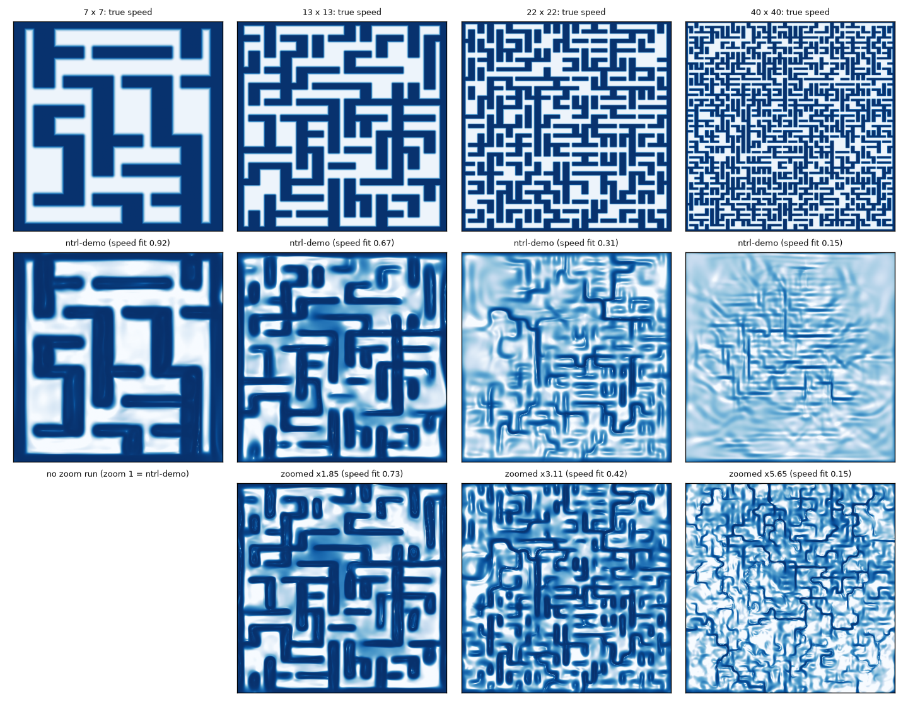

# Maze scale: how ntrl-demo copes with bigger mazes, and whether segment DP helps long trajectories

Request (2026-11-01): test ntrl-demo on small and big environments. Five 2-D mazes (the last 10× larger), planning in
SE(2) with rotation, mazes as `.obj`; query ntrl-demo with queries binned by distance; then try segment DP and see
whether it helps long trajectories.

Everything below is from registered runs (run index at the end); success = ntrl-demo's MPPI over planning seeds 0/1/2,
pooled over training seeds 87358/1/2 unless a cell says otherwise. Full tables: `report/tables.md`; near-wall
mechanism: `report/wallfeel.md`; failure geometry: `report/posthoc.md`.

## Summary

*MPPI success by true travel distance; ntrl-demo pools training seeds 87358 / 1 / 2 (whisker = seed range), so do
segment DP and segment DP + wall term on 13×13; every other point is training seed 87358.*

1. **ntrl-demo is perfect up to the size of its own demo maze and falls apart beyond it.** On 4×4 and 7×7 mazes it
   solves 1,077/1,080 and 1,437/1,440 runs: every distance bin, including the longest (8–16 cells). On 13×13 it solves
   59 % (1,060/1,800; training seeds 53–66 %), on 22×22 23 % (505/2,160), on 40×40 11 % (268/2,520). The oracle (the
   same MPPI on the true travel time) solves 100 % of every bin of every maze, so the losses are the field's.
2. **Distance matters only once the maze is big, and even short queries suffer there.** At 7×7 success is flat in
   distance. At 13×13 it falls from 94 % (0.5–2 cells) to 19 % (16–32 cells; training seeds 3–28 %); at 22×22 from
   75 % to 5 %; at 40×40 from 66 % to 0 % beyond 4 cells. But a 2–4-cell query is solved 100 % in the 7×7 maze, 78 % in 13×13, 32 % in
   22×22 and 8 % in 40×40: the field degrades everywhere as the maze grows, and long queries add up local errors.
   On the 40×40 maze ntrl-demo does no better than driving straight at the goal in any bin (66 vs 62 %, 8 vs 5 %, then 0).
3. **ntrl-demo fails by hitting walls, and the walls fade out of its field.** Every failed ntrl-demo run touches a wall
   while driving (planning seed 0: all of them on 13×13 and 40×40; at most 3 of 40 per bin stall instead). The learned speed 1/|∇T| matches the true
   speed less and less (log-correlation on held-out pairs 0.96, 0.92, 0.69, 0.32, 0.16 from 4 to 40 cells). At
   near-wall poses the field's rise into the wall (S·|∇T|, target 1) falls from 0.84–0.89 to 0.20 and its direction
   (cosine with "into the wall") from 0.98 to 0.07–0.10 at 40 cells. On the 40×40 maze MPPI hits the first wall it
   meets, a median 0.4–0.8 cells after the start.
4. **Control: input resolution explains part of it, capacity the rest.** Training ntrl-demo on zoomed coordinates
   (one cell spans the same input length as in the 7×7 maze; equivalent to scaling its Fourier matrix B) recovers a
   lot at 13×13 (444 vs 347/600 for the same training seed, 74 %; better in every bin) and some at 22×22 (213 vs
   152/720), but not at 40×40 (108 vs 89/840, speed fit unchanged at 0.15): one network does not hold ~1,400 walls
   even at the right frequency.
5. **Segment DP as a value chain makes the field better and the planner worse.** Interval DP over geometric gap
   segments (0.5 cells up to the maze diameter, one ntrl-demo network per segment, each fit to min-over-split-point
   targets built from the shorter segments, ntrl-demo's own field below 0.5 cells) fixes the long-range travel times
   (13×13, 16–32 cells: 1.35 × T* vs 2.04) and descent directions (cosine 0.92 vs 0.88), yet plans worse on every maze
   that is not already solved: 13×13 262 / 280 / 263 vs 347 / 320 / 393 of 600 (training seeds 87358 / 1 / 2), 22×22
   118 vs 152/720, 40×40 85 vs 89/840, 7×7 459 vs 480/480 (4×4 360 = 360; training seed 87358). Mechanism: the DP levels are fit to values only, so they lose the wall barrier
   that ntrl-demo's near-wall terms give its own field (13×13 near-wall slope 0.24–0.29 vs 0.41–0.48, direction
   0.64–0.73 vs 0.89–0.92), and MPPI collides sooner. Neither excluding through-wall base pieces from the DP (22×22:
   132/720) nor a zoomed base (22×22: 169 vs its own 213/720) changes that.
6. **With ntrl-demo's wall term in every DP level, segment DP helps, on short and long trajectories, in the 13- and 22-cell mazes.**
   Fitting ntrl-demo's normal (wall-direction) term at near-wall poses in each level (`segdp3.py`) brings the barrier
   back (13×13 near-wall slope 0.58–0.82, direction 0.97–0.99) and the chains stop hitting walls: their failures become
   stalls, MPPI stopping in a local minimum of the long-range field (13×13, planning seed 0: 3–4 wall contacts in 48–74
   failed runs; `report/paths13.png`, query 161). The term's weight matters. At weight 1 (the cabinet study's setting)
   the long-range values drift low (0.86 × T* at the last level) and long queries stall: 13×13 379 / 400 vs ntrl-demo
   347 / 320 (training seeds 87358 / 1), 16–32 cells 3 / 34 vs 32 / 4 of 120. At weight 0.3 the values stay calibrated
   (1.12 × T*) and the chain is the best field of the study on 13×13: 451 / 456 / 420 of 600 runs against ntrl-demo's
   347 / 320 / 393 on the same training seeds (74 % vs 59 % pooled), better at every distance: 4–8 cells 114 / 107 / 96
   vs 58 / 79 / 77 of 120 and, on the longest trajectories (16–32 cells), 32 / 51 / 29 vs 32 / 4 / 34 (mean 37 vs 23).
   On the bigger mazes (training seed 87358): 22×22 308 vs 152/720 (2–4 cells 84 vs 26, 8–16 cells 36 vs 18, 16–32
   cells 12 vs 6 of 120); 40×40 155 vs 89/840, all of it below 8 cells (2–4 cells 58 vs 11 of 120; nothing beyond 8 cells
   for either). The wall-term levels even give the 40×40 chain the barrier its base lacks (near-wall direction 0.69–0.94
   vs 0.07–0.10). Where ntrl-demo is already perfect the chain costs a little (7×7: 454 vs 480/480, 4–16-cell queries).
   The long-range failures that remain are stalls (22×22: 34 of 36 failures at 16–32 cells; 40×40: 38–40 of 40 in every
   bin from 8 cells).

So, for the question: segment DP as a pure value chain does not help long trajectories in these mazes, because a long
trajectory fails by hitting a wall somewhere along the way, which needs a sharp local barrier that value regression does
not keep. With ntrl-demo's own wall term in every level (weight 0.3) it does help: it removes most wall hits and beats
ntrl-demo at every distance on 13×13 (74 % vs 59 % over three training seeds; longest bin 31 % vs 19 %) and doubles it
on 22×22 (43 % vs 21 %), with the gains largest at 2–16 cells. The longest trajectories are now limited by stalls in
local minima of the long-range field, and on the 40×40 maze nothing tested here gets past 8 cells.

<!--SETUP-->

## Results

### 1. ntrl-demo by maze size and distance

MPPI success (%), pooled over 3 training seeds × 3 planning seeds (per-seed values in `report/tables.md`):

<!--TABLE1-->

Field diagnostics (median per bin, mean over training seeds; `report/tables.md`): T(start, goal)/T* is 0.91–0.93
at 4×4 and 0.96–1.05 at 7×7, then 1.12–2.08 at 13×13 (the long bins overestimate by 2×), 1.01–1.43 at 22×22 and
1.11–1.28 at 40×40. The cosine between the field's descent direction at the start and the truth's is 0.91–0.97 at 4–7
cells and 0.82–0.95 at 13×13; at 22×22 and 40×40 it falls with distance to 0.06 in the longest bins. Spearman
correlation of T with T* over all queries stays 0.97–0.99 at every size: the field orders goals by distance even
when it cannot plan to them.

### 2. Mechanism: the walls fade out

The learned speed 1/|∇_x T(x, goal)| at heading 0 (middle row) redraws every wall of the 7×7 maze, most of the 13×13,
a connected subset of the 22×22 walls and almost none of the 40×40. Held-out near-wall poses (S < 0.3; median
S·|∇T| / cosine of ∇T with the into-wall direction, `report/wallfeel.md`):

<!--TABLE2-->

Failure geometry (`report/posthoc.md`, planning seed 0, training seed 87358; the goal the scorer appends to a run
that never converged is excluded): every failed ntrl-demo run touches a wall while driving; the first contact comes
after a median 0.4–0.9 cells at 22×22 and 40×40 for short queries, within one cell of the start in 22–33 of 40 runs
per bin at 40×40, and after 2.4–4.3 cells (22–41 % of the route) on 13×13.

Zoom control (`zoom.py`): training pairs' coordinates multiplied by s = (n + 0.1)/7.1 (1.845, 3.113, 5.648), the
trained network used on the original coordinates as the NN with B' = s B and output / s (exact: 0.0 difference in
value and gradient). Success 13×13 444/600 (74 %; ntrl-demo 320–393), 22×22 213/720 (ntrl-demo 152–186), 40×40
108/840 (86–93). The bottom row of the speed maps shows the zoomed fields: walls over the whole 22×22 maze (speed fit
0.42 vs 0.31), fine structure everywhere on 40×40 but only a fraction of the walls in place (0.15).

### 3. Segment DP

`segdp.py`: the interval-DP transition of `jeffrey/segment_dp` on maze C-space gaps,
T_(m+1)(i, j) = min_k T_≤m(i, k) + T_≤m(k, j) with |i − k|, |k − j| ≤ e_m (1 + blend). Edges are geometric in cells
(0.5, ×1.35, … to the 99.9th-percentile pool gap; 8 levels at 4×4, 16 at 40×40, blend ±5 %); below 0.5 cells the chain
is ntrl-demo's trained field; each level is an ntrl-demo `metric` network warm-started from the previous level and fit
for 6,000 steps (batch 2,000, AdamW 5·10⁻⁴) with |log T − log y| to the DP targets of 100,000 pool pairs (200,000
collision-free pool poses; 128 split candidates per pair, half nearest the straight line, half uniform in the lens).
The chain is planned with the same MPPI and diagnosed the same way. Variants: `--check-pieces` (a base piece counts
only if its straight segment is collision-free), `segdp2.py` (zoomed base), `segdp3.py` (ntrl-demo's normal term at
near-wall poses paired with goals in each level's segment, weight 1 as `jeffrey/segment_dp` dp3 `--normal-weight`,
and 0.3).

<!--TABLE3-->

Per-level truth probes (pool pose → truth goal pairs in each segment): the DP targets track the trained levels to
0.2–3 % (held-out |log|) and sit at 1.07–1.36 × T* on 13×13 and 22×22 (ntrl-demo's own short-range bias, 1.03–1.2,
plus split-point detours), against 1.03–1.96 × for ntrl-demo itself at the same gaps on 13×13.

## Caveats

- On 13×13 ntrl-demo, segment DP and both wall-term weights have three training seeds each; every other DP and zoom
  number is training seed 87358 only. ntrl-demo's 13×13 seeds differ by up to 73 runs of 600 (320–393), mostly in the
  long bins, so single-seed differences smaller than that are not separations (the 22×22 and 40×40 wall-term gains,
  +156 and +66, are larger than the seed spread there: 152–186 and 86–93).
- The wall-term weight was tried at 1 and 0.3 only, on 13×13 first (one seed) and then carried to the other mazes.
- One maze per size (seed 1000 + n); a different layout of the same size would move the numbers.
- 40 queries per distance bin; bins a maze cannot reach are absent (4×4 reaches 4–8 cells, 40×40 64–128).
- The planner is ntrl-demo's MPPI scaled per cell; a gradient-descent planner or a wider MPPI was not tried here.
- Zoom changes three things at once (Fourier frequency per cell, TD step 0.03/s, time units); the planner sees the
  same time units because the output is divided by s.
- ntrl-demo's `metric` package was run unchanged except for the data recipe being applied in the unit cube the
  C-space box maps to (see Setup); its TD step (0.03 of the box) spans 1.2 cells at 40×40.

## Reproduce

    CUDA_DEVICE_ORDER=PCI_BUS_ID CUDA_VISIBLE_DEVICES=1 ~/.venvs/bellman-ntfield/bin/python jeffrey/maze_scale/run.py prepare --n 13
    CUDA_DEVICE_ORDER=PCI_BUS_ID CUDA_VISIBLE_DEVICES=1 ~/.venvs/bellman-ntfield/bin/python jeffrey/maze_scale/run.py ntrl --prepared results/registered_<prepare id> --seed 87358
    CUDA_DEVICE_ORDER=PCI_BUS_ID CUDA_VISIBLE_DEVICES=1 ~/.venvs/bellman-ntfield/bin/python jeffrey/maze_scale/run.py zoom --prepared ... --seed 87358 --zoom 1.8450704225352113
    CUDA_DEVICE_ORDER=PCI_BUS_ID CUDA_VISIBLE_DEVICES=1 ~/.venvs/bellman-ntfield/bin/python jeffrey/maze_scale/run.py segdp --prepared ... --base results/registered_<ntrl id>/training/checkpoint.pt --seed 87358
    CUDA_DEVICE_ORDER=PCI_BUS_ID CUDA_VISIBLE_DEVICES=1 ~/.venvs/bellman-ntfield/bin/python jeffrey/maze_scale/run.py segdp3 --prepared ... --base ... --seed 87358
    ~/.venvs/bellman-ntfield/bin/python jeffrey/maze_scale/report.py
    CUDA_VISIBLE_DEVICES=0 ~/.venvs/bellman-ntfield/bin/python jeffrey/maze_scale/wallfeel.py
    CUDA_VISIBLE_DEVICES=0 ~/.venvs/bellman-ntfield/bin/python jeffrey/maze_scale/posthoc.py
    CUDA_VISIBLE_DEVICES=0 ~/.venvs/bellman-ntfield/bin/python jeffrey/maze_scale/figs.py
    ~/.venvs/bellman-ntfield/bin/python jeffrey/maze_scale/page.py

Superseded: the first four prepare runs (20261101T192118Z-57dea88a, -645cf7ff, 192127Z-848660ef, 192138Z-d3554001) had
a truth-seeding bug (fixed in `truth.py`; registry notes). Cancelled: 20261101T204642Z-c422c40e (DP on the zoomed 40×40
base, stopped at level 1 because that base was as wall-blind as the default).

## Run index

<!--RUNS-->
