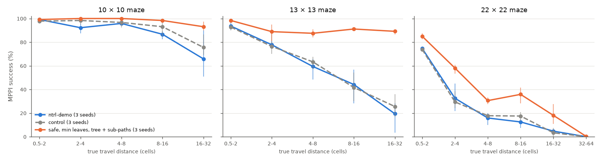
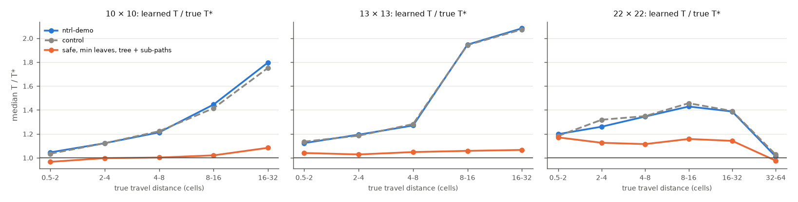

# Travel-time midpoint loss for ntrl-demo

Request (2026-11-02): segment DP's split points assumed distance pieces, but a path around walls can be much longer
than the distance between its ends. Keep ntrl-demo, which is good for local travel times, and add a long-range loss:
sample pairs (a, b), traverse them with MPPI, take c = the **travel-time** midpoint of the traversal (not the distance
midpoint), ask T(a, b) = T(a, c) + T(c, b), and recurse down until the pieces are small enough for the local model.
Batch the queries, use the GPU memory, introduce the loss late (after ~2,000 epochs, optionally ramped), train ntrl-demo
on 10×10, 13×13 and 22×22 mazes against plain ntrl-demo, on the 3090 and the 5070, and keep at it until it beats the
original method.

Everything below comes from registered runs (run index in `report/tables.md`); success is ntrl-demo's MPPI over planning
seeds 0/1/2 on the maze-scale study's certified queries, at the final epoch (5,000), with training seeds 87358/1/2
unless a row says otherwise. Tables: `report/tables.md` (generated by `report.py`); findings page: `report/midpoint.html`,
published at https://claude.ai/artifact/L7QtsFtB8Kk6nGv3mJ8d4U (private until shared). Nothing here is committed.

## Summary

1. **The midpoint loss beats ntrl-demo on all three mazes, on every training seed run.** MPPI success at
   epoch 5,000: 10×10 **98 %** (training seeds 87358 / 1 / 2: 586 / 594 / 586 of 600) vs ntrl-demo 88 % (500 / 523 / 560);
   13×13 **91 %** (536 / 559 / 543) vs 59 % (347 / 320 / 393); 22×22 **38 %** (282 / 281 / 257 of 720, 3 seeds) vs 23 % (152 / 186 / 167).
   The control, the same loop resumed at epoch 2,000 without the term, stays near ntrl-demo's level (92 / 60 / 24 %),
   so the gain is the term's. It is largest at long range: 16-32-cell queries 66 → 93 % on 10×10, 19 → 89 % on
   13×13, 5 → 18 % on 22×22.
2. **It beats ntrl-demo's best input-frequency setting on 10×10 and 13×13, and adds to it on every maze.** The maze-scale
   study's best fix for ntrl-demo was a higher Fourier frequency (B×3 on 10×10 and 13×13, B×6 on 22×22): 95 / 90 / 43 %.
   The midpoint loss on the plain network gets 98 / 91 / 38 %. On the higher-frequency networks it reaches
   **99 / 94 / 59 %**: on 22×22 395 / 398 / 474 of 720 vs 302 / 229 / 395 for B×6 alone (every seed), on 13×13 532 / 578 / 580 of 600
   vs 554 / 529 / 537 (two of three seeds), on 10×10 594 / 593 / 593 vs 592 / 575 / 545.
3. **What it changes: long-range values and, through them, where the field points next to walls.** ntrl-demo overestimates
   long travel times (median T/T* 2.08 at 16-32 cells on 13×13); with the term it is 1.07, and 0.97-1.17 in every bin of
   every maze. MPPI fails mostly by hitting walls, and that is what drops: the share of near-wall poses whose descent direction
   points into the wall falls from 4.0 to 2.3 % (13×13, goals beyond 8 cells; 11.8 → 6.0 % on 22×22), at short
   and mid range as well. Across the 15 13×13 fields of training seed 87358 (baseline, control, variants), this share
   and planning success have a rank correlation of -0.84. The
   near-wall steepness itself changes little; local u-turns around a wall end improve less (30 → 50 % on 13×13,
   vs 81 % for B×3), which is where the higher input frequency helps more.
4. **The recursion needs an anchor that is not the network.** Taken literally, with the network's own T at the leaves and
   the test planner's traversals, the term reaches 446/600 on 13×13 (training seed 87358; control 334/600), slowly and with an
   inflated field (T/T* 1.37 at 0.5-2 cells, 1.67 at 16-32): summing the network's short-range values sums its short-range
   bias. Taking each leaf as the smaller of the network's value and the travel time the robot actually needed over it gives
   506/600 with the test planner's own drives and 501/600 with drives that keep out of walls (data collection only); adding
   random sub-paths between leaf ends to the latter gives 536/600. With network leaves the wall-avoiding drives get only
   382/600: their extra long valid paths add more biased leaves.
5. **Schedule, weight and leaf size** (13×13, training seed 87358, against 536/600): full weight from epoch 2,001 (no ramp)
   514/600; weight 0.3 442/600; weight 3 537/600; term from epoch 3,000 501/600; leaves of 0.5 cells 411/600, 2 cells 524/600. Leaves
   below the scale the local model is trusted at hurt: the 0.5-cell run's values are as calibrated, but its descent near
   walls reverts to ntrl-demo's level for goals under 8 cells, and it collides three times as often.

## Method

**Base.** ntrl-demo's `models/metric` network, trained by its own `Model.train()` loop for 2,000 epochs: the
registered baseline runs of `jeffrey/maze_scale` keep their epoch-2000 checkpoints (network, AdamW state, B), so every
run here forks from exactly the baseline's network at epoch 2000. Epochs 2001-5000 run ntrl-demo's loop unchanged
(`trainer.py`: same data and minibatches of 2,000, its `Function.Loss` with eikonal, TD and wall-normal terms weighted
by exp(-0.5 T) and normalized by its beta, AdamW 5e-4 with weight decay 0.5, epoch rollback when its loss rises 20 %)
plus one term:

    loss = beta * loss_ntrl-demo + lambda(epoch) * mean over nodes |log T(w_s, w_e) - log y(s, e)|

lambda ramps linearly from 0 at epoch 2000 to 1 at epoch 2500. The rollback test and beta see ntrl-demo's loss only.
**Control**: the same resumed loop with lambda = 0 (`--weight 0`), so the comparison isolates the new term.

**Traversals** (`traverse.py`). Every 100 epochs, 8,192 random pairs (a, b) of collision-free poses (clearance >= 0.1
cells, like the test queries) are traversed with ntrl-demo's MPPI on the current network: the test planner's own
algorithm and settings (50 samples, horizon 5, cost 10 T(first) + T(last), step, tolerance and temperature scaled per
cell), batched over all pairs. A traversal stops at the goal, at its step budget (2 T(a, b) / step, at least 200, at
most 5 n cells of motion) or when it stalls (T(current, b) has not fallen by 0.05 cells in 60 steps). The path is cut
before its first collision (exact clearance at every waypoint and segment midpoint) and a stalled path's hover at the
end is trimmed; the point it reached becomes the pair's goal (hindsight), so every traversal yields a valid path.
*Safe* traversals (data collection only) add 100 to the cost of any rollout whose first state comes within 0.02 cells
of a wall; the evaluated planner never does this. *Plain* traversals are exactly the test planner.

**Travel-time midpoints** (`tree.py`). A path w_0 ... w_e is parametrized by its travel time,
cum_i = sum |w_(k+1) - w_k| (1/S(w_k) + 1/S(w_(k+1))) / 2 with S the speed ntrl-demo's labels use. A node [s, e]
is a leaf when its travel time is at most 1 cell (the scale where ntrl-demo's own field is accurate: T/T* 1.05-1.20
at 0.5-2 cells), otherwise it splits at its **travel-time midpoint** m (the waypoint whose cum is nearest
(cum_s + cum_e)/2, not the middle of the distance) into [s, m] and [m, e], recursively. All paths are split together,
one level at a time, with one flat searchsorted. A leaf's value is the local model's T(w_s, w_e) (*net*, the literal
recursion) or min(T(w_s, w_e), the path's own travel time over the leaf) (*min*). Every inner node gets the sum of
the leaf values inside it as its target: T(a, b) should equal T(a, c) + T(c, b), and each half the sum of its own
halves, down to the local model. *tree + sub-paths* adds as many random sub-paths between leaf boundaries (any [i, j],
not only the dyadic nodes) with the same kind of target.

**Batching.** ntrl-demo's network encodes both poses with the same encoder (Fourier features, two gated sine blocks,
a linear layer and a per-row InstanceNorm) and compares the codes with a smooth max-norm sum. `fastnet.py` splits
the two, so an MPPI step encodes only the 100 rollout end states per pair and reuses the goal's code, and runs the
encoder through `torch.compile` in fp32 on 1,048,576-state chunks: 10.6 M states/s on the RTX 3090, 2.3 times eager
(TF32 was rejected: its error, 0.015, exceeds the cost differences MPPI ranks). The exact clearance used by safe
traversals and the collision cut is compiled too (6-8 times eager). A refresh evaluates about 170 M states and
takes 20-30 s on an idle 3090 (13 x 13), up to ~80 s for 22 x 22 with two runs sharing the card; each training
minibatch adds 8,192 midpoint pairs to ntrl-demo's 2,000.

**Evaluation.** Unchanged from `jeffrey/maze_scale`: the prepared queries (40 per true-distance bin, each certified
by a collision-free truth path), ntrl-demo's MPPI with planning seeds 0/1/2, success = reaching the goal without the
robot touching a wall (exact clearance every 0.005 cells), at the final epoch 5000. Baselines: the registered
ntrl-demo runs (epoch 5000, same three training seeds) and, for the Fourier comparison, the registered ntrl-demo runs
with B x 3 (10 x 10, 13 x 13) and B x 6 (22 x 22), the best scales of the maze-scale sweep.

## Results

### 1. The midpoint loss against ntrl-demo

MPPI success (runs that reach the goal without touching a wall), planning seeds 0/1/2 pooled; per training seed and over all seeds.

| maze | field | seed 87358 | seed 1 | seed 2 | all | % |
|---|---|---|---|---|---|---|
| 10×10 | ntrl-demo | 500/600 | 523/600 | 560/600 | 1583/1800 | 88 |
| 10×10 | control | 541/600 | 555/600 | 565/600 | 1661/1800 | 92 |
| 10×10 | **safe, min leaves, tree + sub-paths** | 586/600 | 594/600 | 586/600 | 1766/1800 | 98 |
| 10×10 | ntrl-demo B×3 | 592/600 | 575/600 | 545/600 | 1712/1800 | 95 |
| 10×10 | safe, min leaves, tree + sub-paths on B×3 | 594/600 | 593/600 | 593/600 | 1780/1800 | 99 |
| 13×13 | ntrl-demo | 347/600 | 320/600 | 393/600 | 1060/1800 | 59 |
| 13×13 | control | 334/600 | 337/600 | 408/600 | 1079/1800 | 60 |
| 13×13 | **safe, min leaves, tree + sub-paths** | 536/600 | 559/600 | 543/600 | 1638/1800 | 91 |
| 13×13 | ntrl-demo B×3 | 554/600 | 529/600 | 537/600 | 1620/1800 | 90 |
| 13×13 | safe, min leaves, tree + sub-paths on B×3 | 532/600 | 578/600 | 580/600 | 1690/1800 | 94 |
| 22×22 | ntrl-demo | 152/720 | 186/720 | 167/720 | 505/2160 | 23 |
| 22×22 | control | 172/720 | 174/720 | 165/720 | 511/2160 | 24 |
| 22×22 | **safe, min leaves, tree + sub-paths** | 282/720 | 281/720 | 257/720 | 820/2160 | 38 |
| 22×22 | ntrl-demo B×6 | 302/720 | 229/720 | 395/720 | 926/2160 | 43 |
| 22×22 | safe, min leaves, tree + sub-paths on B×6 | 395/720 | 398/720 | 474/720 | 1267/2160 | 59 |



*MPPI success by true travel distance, mean over training seeds (whisker: seed range); control = the same resumed loop
without the term.*

Pooled over the training seeds listed above and planning seeds 0/1/2 (%).

| maze | field | 0.5-2 | 2-4 | 4-8 | 8-16 | 16-32 | 32-64 |
|---|---|---|---|---|---|---|---|
| 10×10 | ntrl-demo | 99 | 92 | 96 | 87 | 66 |  |
| 10×10 | control | 98 | 98 | 97 | 93 | 76 |  |
| 10×10 | safe, min leaves, tree + sub-paths | 99 | 100 | 100 | 98 | 93 |  |
| 10×10 | ntrl-demo B×3 | 100 | 99 | 99 | 92 | 86 |  |
| 10×10 | safe, min leaves, tree + sub-paths on B×3 | 100 | 100 | 97 | 98 | 100 |  |
| 13×13 | ntrl-demo | 94 | 78 | 59 | 44 | 19 |  |
| 13×13 | control | 93 | 76 | 63 | 42 | 26 |  |
| 13×13 | safe, min leaves, tree + sub-paths | 98 | 89 | 88 | 91 | 89 |  |
| 13×13 | ntrl-demo B×3 | 99 | 97 | 89 | 91 | 75 |  |
| 13×13 | safe, min leaves, tree + sub-paths on B×3 | 100 | 100 | 94 | 91 | 85 |  |
| 22×22 | ntrl-demo | 75 | 32 | 16 | 12 | 5 | 0 |
| 22×22 | control | 74 | 29 | 18 | 18 | 3 | 0 |
| 22×22 | safe, min leaves, tree + sub-paths | 85 | 58 | 31 | 36 | 18 | 0 |
| 22×22 | ntrl-demo B×6 | 86 | 64 | 42 | 35 | 22 | 8 |
| 22×22 | safe, min leaves, tree + sub-paths on B×6 | 90 | 75 | 60 | 64 | 44 | 19 |

The midpoint loss raises success on every training seed of every maze it was run on, and in every distance bin of the
pooled tables. On 22×22 the plain network gains in every bin but stays far from solved (38 %): it does not draw many of the
458 walls (speed fit 0.32 for ntrl-demo), and the term cannot teach routes around walls the field does not represent; on the
higher-frequency network, which draws more of them, the same term reaches 59 %.

### 2. What changes in the field



Median T(start, goal) / T* per distance bin and median cosine between the field's descent direction at the start and the truth's (mean over training seeds); held-out log-speed correlation (speed fit); near-wall slope S|∇T| / cos(∇T, into the wall) at held-out near-wall poses, gap 0.5-2 and 2-8 cells (training seed 87358).

| maze | field | T/T* by bin | descent cos | speed fit | near wall 0.5-2 | near wall 2-8 |
|---|---|---|---|---|---|---|
| 10×10 | ntrl-demo | 1.05 / 1.12 / 1.21 / 1.44 / 1.80 | 0.905 | 0.81 | 0.57 / 0.95 | 0.62 / 0.96 |
| 10×10 | control | 1.03 / 1.12 / 1.22 / 1.41 / 1.75 | 0.908 | 0.82 | 0.55 / 0.95 | 0.60 / 0.96 |
| 10×10 | safe, min leaves, tree + sub-paths | 0.97 / 1.00 / 1.00 / 1.02 / 1.08 | 0.943 | 0.84 | 0.63 / 0.96 | 0.68 / 0.97 |
| 10×10 | ntrl-demo B×3 | 0.99 / 1.03 / 1.11 / 1.27 / 1.54 | 0.922 | 0.90 | 0.76 / 0.97 | 0.80 / 0.98 |
| 10×10 | safe, min leaves, tree + sub-paths on B×3 | 0.98 / 1.00 / 1.00 / 1.02 / 1.06 | 0.947 | 0.91 | 0.76 / 0.97 | 0.81 / 0.98 |
| 13×13 | ntrl-demo | 1.12 / 1.19 / 1.27 / 1.95 / 2.08 | 0.879 | 0.69 | 0.41 / 0.89 | 0.48 / 0.92 |
| 13×13 | control | 1.13 / 1.18 / 1.28 / 1.94 / 2.07 | 0.895 | 0.68 | 0.41 / 0.89 | 0.48 / 0.92 |
| 13×13 | safe, min leaves, tree + sub-paths | 1.04 / 1.03 / 1.05 / 1.06 / 1.07 | 0.930 | 0.75 | 0.43 / 0.92 | 0.50 / 0.95 |
| 13×13 | ntrl-demo B×3 | 1.06 / 1.08 / 1.12 / 1.56 / 1.63 | 0.923 | 0.84 | 0.63 / 0.96 | 0.68 / 0.96 |
| 13×13 | plain, min leaves, tree | 1.03 / 1.02 / 1.05 / 1.21 / 1.29 | 0.912 | 0.77 | 0.47 / 0.94 | 0.55 / 0.95 |
| 13×13 | plain, net leaves, tree | 1.37 / 1.41 / 1.45 / 1.61 / 1.67 | 0.900 | 0.73 | 0.47 / 0.90 | 0.53 / 0.94 |
| 13×13 | safe, min leaves, tree + sub-paths (ramp 1) | 1.03 / 1.02 / 1.03 / 1.05 / 1.06 | 0.932 | 0.78 | 0.52 / 0.95 | 0.60 / 0.96 |
| 13×13 | safe, min leaves, tree + sub-paths (weight 0.3) | 1.05 / 1.06 / 1.08 / 1.18 / 1.26 | 0.897 | 0.70 | 0.43 / 0.92 | 0.50 / 0.94 |
| 13×13 | safe, min leaves, tree + sub-paths on B×3 | 1.02 / 1.00 / 1.01 / 1.02 / 1.04 | 0.941 | 0.85 | 0.65 / 0.96 | 0.70 / 0.97 |
| 13×13 | safe, net leaves, tree | 1.43 / 1.50 / 1.50 / 1.80 / 1.88 | 0.875 | 0.70 | 0.44 / 0.88 | 0.50 / 0.92 |
| 13×13 | safe, min leaves, tree + sub-paths (leaf_cells 0.5) | 1.03 / 1.04 / 1.05 / 1.04 / 1.05 | 0.921 | 0.72 | 0.44 / 0.92 | 0.54 / 0.95 |
| 13×13 | safe, min leaves, tree + sub-paths (leaf_cells 2.0) | 1.07 / 1.04 / 1.05 / 1.05 / 1.06 | 0.930 | 0.75 | 0.49 / 0.94 | 0.56 / 0.95 |
| 13×13 | safe, min leaves, tree + sub-paths (weight 3) | 1.05 / 1.01 / 1.03 / 1.03 / 1.03 | 0.917 | 0.77 | 0.51 / 0.94 | 0.60 / 0.96 |
| 13×13 | safe, min leaves, tree | 1.05 / 1.04 / 1.06 / 1.24 / 1.35 | 0.914 | 0.72 | 0.45 / 0.92 | 0.54 / 0.95 |
| 13×13 | safe, min leaves, tree + sub-paths (start 3000) | 1.06 / 1.05 / 1.05 / 1.05 / 1.06 | 0.907 | 0.73 | 0.47 / 0.93 | 0.55 / 0.95 |
| 22×22 | ntrl-demo | 1.20 / 1.26 / 1.34 / 1.43 / 1.39 / 1.01 | 0.791 | 0.32 | 0.23 / 0.35 | 0.24 / 0.56 |
| 22×22 | control | 1.18 / 1.32 / 1.35 / 1.46 / 1.39 / 1.03 | 0.813 | 0.34 | 0.23 / 0.39 | 0.26 / 0.62 |
| 22×22 | safe, min leaves, tree + sub-paths | 1.17 / 1.13 / 1.11 / 1.16 / 1.14 / 0.98 | 0.830 | 0.43 | 0.25 / 0.61 | 0.29 / 0.76 |
| 22×22 | ntrl-demo B×6 | 1.21 / 1.14 / 1.42 / 1.67 / 1.79 / 1.70 | 0.841 | 0.66 | 0.42 / 0.87 | 0.51 / 0.91 |
| 22×22 | safe, min leaves, tree + sub-paths on B×6 | 1.09 / 1.03 / 1.08 / 1.13 / 1.15 / 1.11 | 0.871 | 0.70 | 0.42 / 0.89 | 0.49 / 0.92 |

Share of near-wall poses whose descent direction points into the wall (component > 0.3 along the into-wall normal), by the goal's true distance in cells, and median free-space |∇T| for goals >= 8 cells (truth 1); mean over training seeds.

| maze | field | seeds | into wall, 0.5-2 (%) | into wall, 2-8 (%) | into wall, >8 (%) | free-space abs grad T |
|---|---|---|---|---|---|---|
| 10×10 | ntrl-demo | 3 | 1.6 | 1.5 | 2.5 | 1.11 |
| 10×10 | control | 3 | 1.4 | 1.4 | 2.3 | 1.08 |
| 10×10 | safe, min leaves, tree + sub-paths | 3 | 1.3 | 0.9 | 1.1 | 1.01 |
| 10×10 | ntrl-demo B×3 | 3 | 0.8 | 0.6 | 1.3 | 1.06 |
| 10×10 | safe, min leaves, tree + sub-paths on B×3 | 3 | 1.0 | 0.5 | 0.6 | 1.02 |
| 13×13 | ntrl-demo | 3 | 4.3 | 3.3 | 4.0 | 1.14 |
| 13×13 | control | 3 | 4.0 | 3.4 | 4.4 | 1.14 |
| 13×13 | safe, min leaves, tree + sub-paths | 3 | 2.8 | 1.7 | 2.3 | 1.05 |
| 13×13 | ntrl-demo B×3 | 3 | 1.6 | 1.1 | 1.8 | 1.08 |
| 13×13 | safe, min leaves, tree + sub-paths on B×3 | 3 | 1.4 | 0.8 | 1.1 | 1.03 |
| 13×13 | plain, min leaves, tree | 1 | 2.9 | 1.7 | 2.1 | 1.05 |
| 13×13 | plain, net leaves, tree | 1 | 5.2 | 3.2 | 3.4 | 1.12 |
| 13×13 | safe, min leaves, tree | 1 | 3.2 | 2.3 | 3.2 | 1.05 |
| 13×13 | safe, min leaves, tree + sub-paths (leaf_cells 0.5) | 1 | 5.0 | 4.2 | 2.1 | 1.02 |
| 13×13 | safe, min leaves, tree + sub-paths (leaf_cells 2.0) | 1 | 2.9 | 1.8 | 1.7 | 1.04 |
| 13×13 | safe, min leaves, tree + sub-paths (ramp 1) | 1 | 2.4 | 1.5 | 1.7 | 1.01 |
| 13×13 | safe, min leaves, tree + sub-paths (start 3000) | 1 | 3.7 | 2.7 | 2.8 | 1.04 |
| 13×13 | safe, min leaves, tree + sub-paths (weight 0.3) | 1 | 3.6 | 2.7 | 3.0 | 1.08 |
| 13×13 | safe, min leaves, tree + sub-paths (weight 3) | 1 | 3.8 | 1.6 | 1.6 | 1.04 |
| 13×13 | safe, net leaves, tree | 1 | 4.8 | 3.4 | 3.5 | 1.12 |
| 22×22 | ntrl-demo | 3 | 14.7 | 16.0 | 11.8 | 1.13 |
| 22×22 | control | 3 | 14.8 | 14.7 | 10.5 | 1.12 |
| 22×22 | safe, min leaves, tree + sub-paths | 3 | 9.7 | 7.7 | 6.0 | 1.08 |
| 22×22 | ntrl-demo B×6 | 3 | 6.3 | 4.1 | 4.0 | 1.17 |
| 22×22 | safe, min leaves, tree + sub-paths on B×6 | 3 | 5.0 | 2.8 | 3.0 | 1.10 |

Per planning run: collision = touched a wall; stall = never reached the goal without touching a wall (planning seeds and training seeds pooled).

| maze | field | runs | success | collision | stall only |
|---|---|---|---|---|---|
| 10×10 | ntrl-demo | 1800 | 1583 | 212 | 5 |
| 10×10 | control | 1800 | 1661 | 134 | 5 |
| 10×10 | safe, min leaves, tree + sub-paths | 1800 | 1766 | 34 | 0 |
| 10×10 | ntrl-demo B×3 | 1800 | 1712 | 88 | 0 |
| 10×10 | safe, min leaves, tree + sub-paths on B×3 | 1800 | 1780 | 20 | 0 |
| 13×13 | ntrl-demo | 1800 | 1060 | 737 | 3 |
| 13×13 | control | 1800 | 1079 | 712 | 9 |
| 13×13 | safe, min leaves, tree + sub-paths | 1800 | 1638 | 162 | 0 |
| 13×13 | ntrl-demo B×3 | 1800 | 1620 | 179 | 1 |
| 13×13 | safe, min leaves, tree + sub-paths on B×3 | 1800 | 1690 | 110 | 0 |
| 22×22 | ntrl-demo | 2160 | 505 | 1655 | 0 |
| 22×22 | control | 2160 | 511 | 1649 | 0 |
| 22×22 | safe, min leaves, tree + sub-paths | 2160 | 820 | 1340 | 0 |
| 22×22 | ntrl-demo B×6 | 2160 | 926 | 1234 | 0 |
| 22×22 | safe, min leaves, tree + sub-paths on B×6 | 2160 | 1267 | 886 | 7 |

ntrl-demo's own loss constrains |∇T| and the direction of ∇T next to walls at sampled poses; nothing ties distant poses
together, and its long-range values drift high (up to twice the true travel time on 13×13). The midpoint targets fix those
values directly: on the baseline's field at epoch 2,000, the target of a traversed path that reached its goal is 10-12 %
above the true travel time (median, anchored leaves of 0.5-2 cells), while the network's own T is 64-111 % above it at 8-32
cells (development check: 8,192 plain traversals from random starts to the truth goals). After training, T/T* is
0.97-1.17 in every bin.

The planner gains because MPPI fails by driving into walls, and that happens where the descent direction near a wall points
into it: the goal is behind the wall and the field does not know the way round. With correct long-range values for pairs
whose route goes around the wall, the descent direction there turns along it. The share of such poses falls by a third to a
half on 13×13
(4.3 / 3.3 / 4.0 % → 2.8 / 1.7 / 2.3 % for goals at 0.5-2 / 2-8 / > 8 cells) and on 22×22
(14.7 / 16.0 / 11.8 → 9.7 / 7.7 / 6.0 %), and collisions fall accordingly (failure table). The
free-space gradient also comes down to its true value (|∇T| 1.11-1.14 → 1.01-1.07). The steepness of the barrier next to a
wall moves little (held-out near-wall slope, field table): the term changes where the field points, not how steep it is.

Across the 15 13×13 fields of training seed 87358 (section 4 and the baselines), the into-wall share (mean of the three
goal ranges) and planning success have a rank correlation of -0.84: the literal variant, weight 0.3 and the 0.5-cell leaves
keep the share near ntrl-demo's level at short and mid range and plan worse.

### 3. U-turns around a wall end

jeffrey/maze_scale u-turn queries (40 per maze: start and goal 1 cell apart on either side of a wall end, true path ~2.2 cells around it), planning seeds 0/1/2; per training seed and pooled. Inference on the registered checkpoints.

| maze | field | seed 87358 | seed 1 | seed 2 | all | % |
|---|---|---|---|---|---|---|
| 10×10 | ntrl-demo | 87/120 | 117/120 | 95/120 | 299/360 | 83 |
| 10×10 | control | 90/120 | 109/120 | 96/120 | 295/360 | 82 |
| 10×10 | safe, min leaves, tree + sub-paths | 109/120 | 109/120 | 105/120 | 323/360 | 90 |
| 10×10 | ntrl-demo B×3 | 113/120 | 115/120 | 119/120 | 347/360 | 96 |
| 10×10 | safe, min leaves, tree + sub-paths on B×3 | 117/120 | 113/120 | 120/120 | 350/360 | 97 |
| 13×13 | ntrl-demo | 24/120 | 39/120 | 45/120 | 108/360 | 30 |
| 13×13 | control | 47/120 | 40/120 | 35/120 | 122/360 | 34 |
| 13×13 | safe, min leaves, tree + sub-paths | 58/120 | 69/120 | 53/120 | 180/360 | 50 |
| 13×13 | ntrl-demo B×3 | 93/120 | 112/120 | 85/120 | 290/360 | 81 |
| 13×13 | safe, min leaves, tree + sub-paths on B×3 | 100/120 | 103/120 | 96/120 | 299/360 | 83 |
| 22×22 | ntrl-demo | 4/120 | 3/120 | 3/120 | 10/360 | 3 |
| 22×22 | control | 1/120 | 0/120 | 6/120 | 7/360 | 2 |
| 22×22 | safe, min leaves, tree + sub-paths | 21/120 | 26/120 | 21/120 | 68/360 | 19 |
| 22×22 | ntrl-demo B×6 | 32/120 | 12/120 | 48/120 | 92/360 | 26 |
| 22×22 | safe, min leaves, tree + sub-paths on B×6 | 48/120 | 51/120 | 62/120 | 161/360 | 45 |

A u-turn is a 1-cell query around a wall end; it tests how sharply a single wall is drawn, not long-range routing. The
midpoint loss helps (83 → 90 % on 10×10, 30 → 50 % on 13×13, 3 → 19 % on 22×22) but less than the
higher input frequency (96 / 81 / 26 %), and the two add up on 22×22 (45 % on B×6, one seed). The two fixes
address different failures: resolution near one wall (Fourier scale) and the field's direction near walls from long-range
values (midpoint loss).

### 4. Which parts matter

Every registered midpoint variant (planning seeds pooled; training seeds as listed).

| maze | variant | seeds | success | % | 0.5-2 | 2-4 | 4-8 | 8-16 | 16-32 | 32-64 |
|---|---|---|---|---|---|---|---|---|---|---|
| 10×10 | ntrl-demo | 1, 2, 87358 | 1583/1800 | 88 | 99 | 92 | 96 | 87 | 66 |  |
| 10×10 | control | 1, 2, 87358 | 1661/1800 | 92 | 98 | 98 | 97 | 93 | 76 |  |
| 10×10 | ntrl-demo B×3 | 1, 2, 87358 | 1712/1800 | 95 | 100 | 99 | 99 | 92 | 86 |  |
| 10×10 | safe, min leaves, tree + sub-paths | 1, 2, 87358 | 1766/1800 | 98 | 99 | 100 | 100 | 98 | 93 |  |
| 10×10 | safe, min leaves, tree + sub-paths on B×3 | 1, 2, 87358 | 1780/1800 | 99 | 100 | 100 | 97 | 98 | 100 |  |
| 13×13 | ntrl-demo | 1, 2, 87358 | 1060/1800 | 59 | 94 | 78 | 59 | 44 | 19 |  |
| 13×13 | control | 1, 2, 87358 | 1079/1800 | 60 | 93 | 76 | 63 | 42 | 26 |  |
| 13×13 | ntrl-demo B×3 | 1, 2, 87358 | 1620/1800 | 90 | 99 | 97 | 89 | 91 | 75 |  |
| 13×13 | plain, min leaves, tree | 87358 | 506/600 | 84 | 94 | 90 | 83 | 89 | 65 |  |
| 13×13 | plain, net leaves, tree | 87358 | 446/600 | 74 | 97 | 82 | 62 | 68 | 63 |  |
| 13×13 | safe, min leaves, tree | 87358 | 501/600 | 84 | 100 | 75 | 89 | 88 | 66 |  |
| 13×13 | safe, min leaves, tree + sub-paths | 1, 2, 87358 | 1638/1800 | 91 | 98 | 89 | 88 | 91 | 89 |  |
| 13×13 | safe, min leaves, tree + sub-paths (leaf_cells 0.5) | 87358 | 411/600 | 68 | 90 | 84 | 64 | 62 | 42 |  |
| 13×13 | safe, min leaves, tree + sub-paths (leaf_cells 2.0) | 87358 | 524/600 | 87 | 99 | 88 | 84 | 88 | 78 |  |
| 13×13 | safe, min leaves, tree + sub-paths (ramp 1) | 87358 | 514/600 | 86 | 97 | 91 | 78 | 92 | 70 |  |
| 13×13 | safe, min leaves, tree + sub-paths (start 3000) | 87358 | 501/600 | 84 | 98 | 76 | 87 | 83 | 73 |  |
| 13×13 | safe, min leaves, tree + sub-paths (weight 0.3) | 87358 | 442/600 | 74 | 98 | 82 | 71 | 71 | 47 |  |
| 13×13 | safe, min leaves, tree + sub-paths (weight 3) | 87358 | 537/600 | 90 | 100 | 87 | 90 | 90 | 81 |  |
| 13×13 | safe, min leaves, tree + sub-paths on B×3 | 1, 2, 87358 | 1690/1800 | 94 | 100 | 100 | 94 | 91 | 85 |  |
| 13×13 | safe, net leaves, tree | 87358 | 382/600 | 64 | 95 | 76 | 63 | 53 | 31 |  |
| 22×22 | ntrl-demo | 1, 2, 87358 | 505/2160 | 23 | 75 | 32 | 16 | 12 | 5 | 0 |
| 22×22 | control | 1, 2, 87358 | 511/2160 | 24 | 74 | 29 | 18 | 18 | 3 | 0 |
| 22×22 | ntrl-demo B×6 | 1, 2, 87358 | 926/2160 | 43 | 86 | 64 | 42 | 35 | 22 | 8 |
| 22×22 | safe, min leaves, tree + sub-paths | 1, 2, 87358 | 820/2160 | 38 | 85 | 58 | 31 | 36 | 18 | 0 |
| 22×22 | safe, min leaves, tree + sub-paths on B×6 | 1, 2, 87358 | 1267/2160 | 59 | 90 | 75 | 60 | 64 | 44 | 19 |

All variants on 13×13, training seed 87358 unless listed, against the control (334/600) and the main configuration (536/600):

- **Literal recursion** (network T at the leaves, the test planner's own traversals, the midpoint tree only): 446/600. It works,
  but slowly (it stayed within the control's range until epoch 4,000) and leaves the whole field inflated, because each leaf's
  value carries ntrl-demo's short-range overestimate and the targets add them up.
- **Anchored leaves** (min of the network's T and the travel time actually driven over the leaf): 506/600 with the test
  planner's traversals. The anchor is what makes the targets informative: at the first refresh (the baseline's field) the
  network's T is a median 26 % above the anchored targets, against 1 % above the network-leaf targets.
- **Collision-aware traversals** (data collection only): with anchored leaves and the tree only 501/600, about the same as
  the test planner's own drives (506/600); adding random sub-paths between leaf ends gives 536/600. With network leaves
  382/600: the extra long valid paths add more biased leaves. On 13×13 the wall-avoiding drives matter less than the anchor;
  they do make nearly every training drive usable (section 5), which matters most where the test planner collides most.
- **Schedule and weight**: no ramp 514/600; weight 0.3 442/600; weight 3 537/600; term from epoch 3,000 (resumed at 2,000) 501/600.
- **Leaf size** (where the recursion stops): 0.5 cells 411/600; 1 cell 536/600; 2 cells 524/600.

### 5. Training traversals

Share of the refresh's MPPI traversals (random collision-free pairs, current field) that reach their goal without touching a wall, at the first refresh (epoch 2001, the baseline's field) and the last; and the median log(T / target) over the bank at those refreshes.

| maze | variant | seed | reached first | reached last | stalled first | stalled last | log(T/target) first | last |
|---|---|---|---|---|---|---|---|---|
| 10×10 | safe, min leaves, tree + sub-paths | 1 | 99 % | 99 % | 1 % | 1 % | 0.174 | 0.009 |
| 10×10 | safe, min leaves, tree + sub-paths | 2 | 96 % | 100 % | 4 % | 0 % | 0.120 | 0.002 |
| 10×10 | safe, min leaves, tree + sub-paths | 87358 | 98 % | 99 % | 2 % | 1 % | 0.154 | -0.004 |
| 10×10 | safe, min leaves, tree + sub-paths on B×3 | 1 | 92 % | 98 % | 8 % | 2 % | 0.114 | 0.004 |
| 10×10 | safe, min leaves, tree + sub-paths on B×3 | 2 | 94 % | 99 % | 6 % | 1 % | 0.097 | 0.001 |
| 10×10 | safe, min leaves, tree + sub-paths on B×3 | 87358 | 95 % | 99 % | 5 % | 1 % | 0.127 | 0.000 |
| 13×13 | plain, min leaves, tree | 87358 | 46 % | 83 % | 3 % | 1 % | 0.235 | 0.001 |
| 13×13 | plain, net leaves, tree | 87358 | 47 % | 59 % | 3 % | 1 % | 0.013 | -0.006 |
| 13×13 | safe, min leaves, tree | 87358 | 95 % | 96 % | 5 % | 4 % | 0.203 | -0.000 |
| 13×13 | safe, min leaves, tree + sub-paths | 1 | 93 % | 98 % | 6 % | 2 % | 0.243 | -0.002 |
| 13×13 | safe, min leaves, tree + sub-paths | 2 | 94 % | 98 % | 6 % | 2 % | 0.237 | 0.004 |
| 13×13 | safe, min leaves, tree + sub-paths | 87358 | 95 % | 94 % | 5 % | 6 % | 0.272 | 0.003 |
| 13×13 | safe, min leaves, tree + sub-paths (leaf_cells 0.5) | 87358 | 95 % | 98 % | 5 % | 2 % | 0.289 | 0.012 |
| 13×13 | safe, min leaves, tree + sub-paths (leaf_cells 2.0) | 87358 | 95 % | 98 % | 5 % | 2 % | 0.271 | 0.005 |
| 13×13 | safe, min leaves, tree + sub-paths (ramp 1) | 87358 | 95 % | 98 % | 5 % | 2 % | 0.278 | -0.004 |
| 13×13 | safe, min leaves, tree + sub-paths (start 3000) | 87358 | 95 % | 98 % | 4 % | 1 % | 0.273 | -0.000 |
| 13×13 | safe, min leaves, tree + sub-paths (weight 0.3) | 87358 | 95 % | 96 % | 5 % | 4 % | 0.278 | 0.016 |
| 13×13 | safe, min leaves, tree + sub-paths (weight 3) | 87358 | 95 % | 99 % | 5 % | 1 % | 0.272 | 0.004 |
| 13×13 | safe, min leaves, tree + sub-paths on B×3 | 1 | 90 % | 95 % | 10 % | 5 % | 0.293 | -0.004 |
| 13×13 | safe, min leaves, tree + sub-paths on B×3 | 2 | 93 % | 97 % | 7 % | 3 % | 0.186 | 0.003 |
| 13×13 | safe, min leaves, tree + sub-paths on B×3 | 87358 | 95 % | 97 % | 5 % | 3 % | 0.246 | 0.005 |
| 13×13 | safe, net leaves, tree | 87358 | 95 % | 95 % | 5 % | 4 % | 0.004 | -0.017 |
| 22×22 | safe, min leaves, tree + sub-paths | 1 | 28 % | 45 % | 68 % | 53 % | -0.183 | -0.101 |
| 22×22 | safe, min leaves, tree + sub-paths | 2 | 39 % | 54 % | 57 % | 44 % | -0.069 | -0.026 |
| 22×22 | safe, min leaves, tree + sub-paths | 87358 | 29 % | 63 % | 67 % | 36 % | -0.166 | -0.004 |
| 22×22 | safe, min leaves, tree + sub-paths on B×6 | 1 | 27 % | 61 % | 73 % | 39 % | 0.310 | -0.002 |
| 22×22 | safe, min leaves, tree + sub-paths on B×6 | 2 | 48 % | 68 % | 51 % | 31 % | 0.236 | -0.002 |
| 22×22 | safe, min leaves, tree + sub-paths on B×6 | 87358 | 48 % | 73 % | 51 % | 27 % | 0.335 | 0.010 |

With collision-aware traversals almost every training drive reaches its goal on 10×10 and 13×13 from the first refresh. On
22×22, 51-73 % stall against walls the field does not draw at the first refresh and 27-53 % at the last; the plain network
reaches its goal on 45-63 % of drives at the end, the B×6 network on 61-73 %. The test planner's own
traversals (plain) reach their goal without touching a wall 46 % of the time on the baseline's 13×13 field and 83 % at the end
of training with anchored leaves: the training-time reach rate is a truth-free measure of the same improvement.

### 6. Cost and caveats

- **Cost.** A refresh traverses 8,192 pairs (about 170 M network evaluations) and takes 20-30 s on an idle 3090 for 13×13;
  30 refreshes per run. Epochs 2001-5000 take 18-23 min on the idle 5070 for 10×10 and 13×13 (ntrl-demo alone: 3.5 min), and
  40-55 min per run with two runs sharing the 3090; refreshes are two thirds of that.
- **Geometry use.** ntrl-demo's labels come from the exact clearance at 500,000 sampled pairs. The midpoint term also asks
  the clearance along every traversed path (collision cut, travel-time parametrization, anchored leaves) and, for safe
  traversals, at every rollout's first state: far more queries of the same function. The literal variant uses it only for the
  collision cut and the parametrization and still gains; a control with matched extra clearance queries was not run.
- **Seeds.** The main configuration and the controls have three training seeds on every maze (control: 3 / 3 / 3);
  the Fourier-base runs have 3 / 3 / 3 on 10 / 13 / 22; every variant and ablation is training seed 87358 only. Checkpoints
  drift between epochs (ntrl-demo 13×13: 327-362 of 600 over epochs 1,000-5,000), so single-seed differences under ~30 of 600
  are not meaningful.
- **Choices made on 13×13, training seed 87358** (leaf values, traversal mode, sub-paths) were carried unchanged to the
  other mazes and seeds; the main configuration's three-seed results on 10×10 and 13×13 include that seed.
- **Planner.** Only ntrl-demo's MPPI was evaluated, with the maze-scale settings and budgets; the collision-aware rule is
  used for training traversals only.

### 7. A close-range network Tc in place of the exact speed

Request (2026-11-02): two networks, T (ntrl-demo's, the one that plans) and Tc, trained only on close pairs, so that the
loss asks Tc instead of the geometry. Close pairs chosen (a) away from walls (both ends with clearance ≥ d cells,
|b − a| ≤ 2d) or (b) by an early ntrl-demo checkpoint (pairs within 1 cell kept when its T ≤ tau cells). `closenet.py`:
Tc(a, b) = |b − a|(1 + softplus(h)), h a symmetric MLP on Fourier features (1 cycle/cell, 265k parameters), fit once before
the term starts (4,000 Adam steps, about 12 s) to straight-line travel times of the trained speed. Tc then gives the
running travel time along each traversal (a chain over consecutive waypoints) that places midpoints and leaves, and the
leaf caps min(T, chain time) (`--anchor tc`). Everything else is the main recipe (safe traversals, tree + sub-paths), so
the exact clearance is still used for the collision cut and the safe MPPI moves. "No truth in the loop"
(`--cut tc --ends data --traverse plain`) also lets Tc decide where a traversal hits a wall (a step slower than speed
0.02) and draws traversal ends from ntrl-demo's own labelled points, so the geometry is queried only for Tc's labels.
Tables: `report/tc_tables.md` (`tc_report.py --wall`).

13×13 (success out of 600 per training seed):

| field | 87358 | 1 | 2 | all |
|---|---|---|---|---|
| control (no term) | 334 | 337 | 408 | 1079/1800 (60 %) |
| main recipe, exact speed | 536 | 559 | 543 | 1638/1800 (91 %) |
| Tc (a) d 0.05, 1M pairs | 556 | 558 | 547 | **1661/1800 (92 %)** |
| Tc (a) d 0.05, 200k pairs | 488 | 545 | 516 | 1549/1800 (86 %) |
| Tc (b) epoch 2000, tau 1 | 537 | 532 | 551 | 1620/1800 (90 %) |
| Tc (b) epoch 1000, tau 1 | 553 | 523 | 533 | 1609/1800 (89 %) |
| Tc (b) epoch 2000, no truth in the loop | 512 | 522 | 516 | 1550/1800 (86 %) |

Single-seed sweep (87358): (a) d 0.02 / 0.05 / 0.1 / 0.2 → 419 / 488 / 424 / 354; (a) 30k / 200k / 1M pairs → 502 / 488 / 556;
(b) epoch 1000 / 2000 / 3000 → 553 / 537 / 541; tau 0.5 → 529; leaves capped by Tc of the leaf ends directly (no chain) → 517;
(a) with no truth in the loop → 418.

- **On 13×13 Tc replaces the exact speed.** Tc's leaf times are within 0.3 % (a) to 1 % (b) of the exact driven times (median
  |log ratio| on the diagnostic refreshes), targets shift by under 0.5 %, and T/T* and the near-wall descent match the main
  recipe. Labels cost 0.5-8.8 M clearance queries (once), but the loop with safe traversals still spends about 3,000 M, so
  this is not where the geometry cost goes. Only the no-truth loop removes it (0 queries in the loop): 86 % vs 91 %.
- **(a): d trades wall coverage against reach.** Tc(a) has never seen a pose closer than d to a wall and extrapolates there
  to times too short; large d (0.1, 0.2) raises the share of near-wall descent directions pointing into the wall for near
  goals (6.3 % at d 0.2 vs 2.8 % main). d 0.02 also failed (419, near-wall descent back to the control's level); not
  explained. With no truth in the loop (a) is useless as a collision detector: it flagged 0 of 4,103 true collisions,
  because it never saw a wall. More pairs at d 0.05 helped (1M: three seeds at or above the main recipe).
- **(b): ntrl-demo's selection includes walls.** A third of the kept 13×13 pairs have a wall on the straight line; Tc
  learns them as slow, which makes it a usable collision detector (92-93 % of true collisions, about 450 false flags per
  8,192 traversals) and gives the no-truth loop its 86 %.

22×22 (success out of 720 per training seed):

| field | 87358 | 1 | 2 | all |
|---|---|---|---|---|
| control (no term) | 172 | 174 | 165 | 511/2160 (24 %) |
| main recipe, exact speed | 282 | 281 | 257 | 820/2160 (38 %) |
| Tc (b) epoch 2000, tau 1 | 137 | 251 | 229 | 617/2160 (29 %) |
| Tc (b) epoch 2000, no truth in the loop | 160 | 181 | 188 | 529/2160 (24 %) |

Single seed (87358): (b) tau 0.5 → 248, (b) 1M pairs → 209, (b) epoch 5000 → 181, (a) d 0.05, 1M pairs → 225.

- **On 22×22 Tc does not replace the exact speed.** Mechanism for (b): the 22×22 ntrl-demo field is too smooth to separate
  close from far; it keeps half of all candidates and 53 % of the kept pairs cross a wall (34 % on 13×13). Tc averages over
  same-side and across-wall pairs near walls and overestimates the driven time along the (wall-hugging) safe traversals by
  e^1.2-1.3 ≈ 3.5× near walls (exact in free space). Those leaves get caps that are too high, and the near-wall descent
  share rises to 17-21 % vs 9 % main and 15 % control. A stricter tau, more pairs or the final checkpoint reduce the error but
  not below a factor 2.8 near walls. (a) has small leaf errors (−6 % near walls) but still lands 57 below the main
  recipe on that seed, with higher near-wall descent for near goals (12.8 % vs 9.4 %): the same short-times-below-d effect
  as on 13×13, apparently stronger at this scale. Untested: dropping (b) pairs whose straight line crosses a wall (the
  labels already compute this, so it costs no queries).

Run ids. 13×13: (a) d 0.05 1M `20261102T231024Z-4fa55e15`, `20261103T040704Z-6e9b771b`, `20261103T043024Z-24c2b5ca`;
(a) d 0.05 200k `20261102T191543Z-42309514`, `20261102T200023Z-6cf2391a`, `20261102T204123Z-afe4aca0`;
(b) e2000 `20261102T191543Z-960418d5`, `20261102T201043Z-d3eb806f`, `20261102T202323Z-7907dc7d`;
(b) e1000 `20261102T221443Z-a7e9f1e6`, `20261103T045344Z-48390554`, `20261103T051604Z-b732e1c6`;
(b) no truth `20261102T194403Z-b17d9c75`, `20261102T211323Z-2b3f43e0`, `20261102T211323Z-9964d9e3`;
(a) no truth `20261102T193903Z-7dbb7d13`; d 0.02 `20261102T213943Z-ea8987aa`, d 0.1 `20261102T220203Z-27c7efc4`,
d 0.2 `20261102T222443Z-6df9e5bc`, 30k `20261102T224703Z-19bf7b81`, (b) tau 0.5 `20261102T233344Z-8aa35449`,
direct leaves `20261102T214523Z-d933ed05`, e3000 `20261102T224603Z-86fb08de`. 22×22: (b) e2000 `20261102T235624Z-17817396`,
`20261103T004624Z-483ac757`, `20261103T013504Z-0168c30b`; (b) no truth `20261103T002144Z-7dd1474f`, `20261103T011104Z-c39f28b5`,
`20261103T020024Z-3ba06939`; (a) 1M `20261103T022644Z-1d169b04`, (b) tau 0.5 `20261103T031724Z-5a9637e1`, (b) 1M
`20261103T025304Z-732b3c9c`, (b) e5000 `20261103T034204Z-0b7fdb1b`. All on snapshot `a55e02e51e1c`.

## Reproduce

```
# one run (registered; executes a frozen copy of the sources in snap/<hash>/)
CUDA_DEVICE_ORDER=PCI_BUS_ID CUDA_VISIBLE_DEVICES=1 ~/.venvs/bellman-ntfield/bin/python jeffrey/midpoint_dp/run.py \
    --prepared results/registered_20261101T192504Z-13cf1d04 --base-run results/registered_20261101T203437Z-ebc95225 \
    --seed 87358 --label "safe min both w1" --extra="--weight 1 --leaf min --traverse safe --nodes both"
# the control: --extra="--weight 0"; on a Fourier-scaled base: --base-run <maze_scale fourier run>
# tables, diagnostics (inference on the registered checkpoints), figures, page
~/.venvs/bellman-ntfield/bin/python jeffrey/midpoint_dp/report.py --wall --uturn --grad --figs
~/.venvs/bellman-ntfield/bin/python jeffrey/midpoint_dp/page.py
```

Prepared mazes (jeffrey/maze_scale prepare runs): 10×10 `20261102T032150Z-b0baa8e9`, 13×13 `20261101T192504Z-13cf1d04`,
22×22 `20261101T193403Z-cea05796`. Files: `fastnet.py` (encoder/metric split, compiled evaluation), `traverse.py`
(batched MPPI, collision-aware option, compiled clearance), `tree.py` (travel-time parametrization, midpoint
recursion, leaf values, targets, sub-paths), `trainer.py` (ntrl-demo's loop resumed, plus the term), `pipeline.py`
(train + maze_scale evaluation), `run.py` (registry), `report.py`, `page.py` + `page_template.html`.
