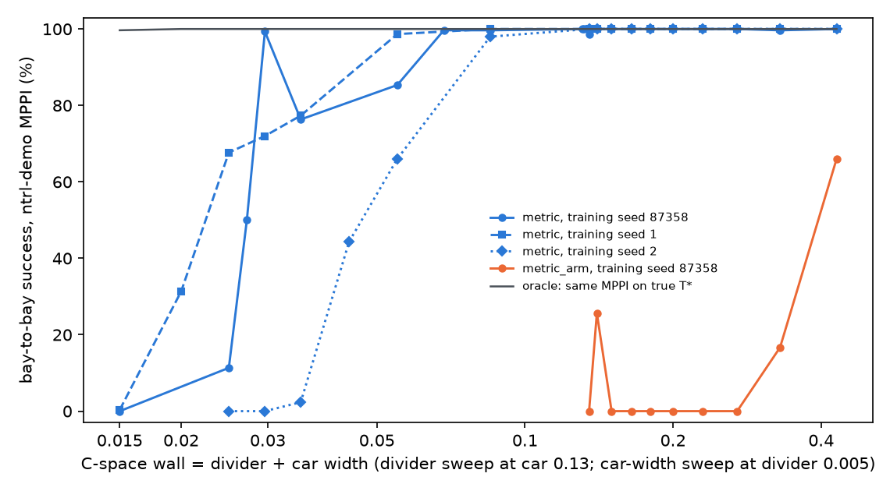
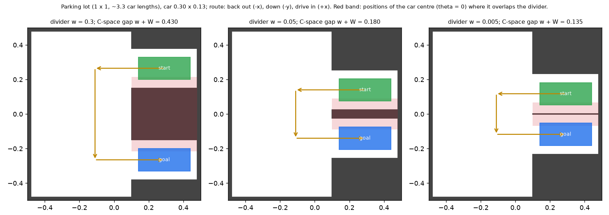

# Parking thin-wall test: how sharp can ntrl-demo's travel-time field get?

Request (2026-10-30): a rectangular car that moves in (x, y, θ) must leave one parking bay and park in the next one:
back out (−x), move down (−y), drive in (+x). The two bays are separated by a wall that gets thinner. Ten wall
thicknesses; measure ntrl-demo's planning success between the bays on both GPUs. Follow-up (2026-10-31): keep the bays
fixed and make the car wider, so the free space beside the parked car shrinks (result 5).

## Results

**1. Thinning the divider never broke ntrl-demo.** With the 0.13-wide car, ntrl-demo's `metric` package solved
296-300 of the 300 bay-to-bay MPPI runs (100 certified queries x planning seeds 0/1/2) per training seed at every
divider thickness from 0.30 down to 0.001 (ten dividers with training seeds 87358/1/2, plus 0.002 and 0.001 with seed
87358). The straight segment crosses the divider in every query (0/100); the oracle (the same MPPI on the true travel
time) solves 300/300; the aisle-to-bay control is 300/300 throughout. ntrl-demo's arm package `metric_arm`
(Fourier matrix 0.2 N(0, 1), one training seed) fails already at thick dividers: 198/300 at 0.30, 50/300 at 0.20 and
0-77/300 below.

**2. Why: the wall the field must resolve is the divider plus the car width.** The planner moves the car centre, so
the forbidden set is every centre position where the car overlaps the divider (red band in the scene figure). With a
0.13-wide car it is never thinner than 0.13; dividers from 0.30 to 0.001 give C-space walls 0.43 to 0.131. The field
resolves that: its travel-time jump across the divider is 0.61-0.78 of the true jump, its overall level 0.72-0.80 of
T*. Thin dividers still leave marks (the jump falls from 0.76-0.78 to 0.61-0.64; at the 0.01 and 0.005 dividers the
descent direction at 30-52 of 100 starts tips toward the wall, none at 0.30; paths pass only slightly closer, median
divider clearance 0.024 vs 0.021), but no collisions with the divider.

**3. Halving the C-space wall (divider 0.005, narrower car; then per-seed bisection).** Success holds at 99.7 % down to
a 0.068 C-space wall and is zero at 0.015 for every seed tested; the oracle stays at 299-300/300 everywhere. In
between, each trained field either resolves the wall or does not. Per training seed, the 50 % crossing is near
0.047 (seed 2: 294 at 0.085, 198 at 0.055, 133 at 0.044, 7 at 0.035), 0.027 (seed 87358: 298 at 0.0296, 150 at 0.0272,
34 at 0.025) and 0.022 (seed 1: 296 at 0.055, 203 at 0.025, 94 at 0.020, 1 at 0.015).

**4. Mechanism: the field, not the planner; the far bay looks close.** Below a 0.1 C-space wall (21 trained fields),
planning success correlates 0.92 with the field's T(start, goal)/T*, 0.82 with its jump across the wall and 0.74 with
the cosine between its descent direction at the start and the true one. Fields that solve >= 200/300 keep 0.62-0.73 of
the true bay-to-bay travel time; fields below 100/300 keep 0.30-0.54. Along a line through both bays
(report/page_far_side.png) every field draws the wall: T rises steeply into it and peaks near the true ridge's depth.
What separates fields that plan from fields that do not is the far-bay level: at the same 0.035 wall, seed 87358
(229/300) puts bay B at 0.58 and seed 2 (7/300) at 0.39 against a true 0.82; at 0.015 the field puts bay B no higher
than the near side of the wall. ntrl-demo never supervises T values: the speed label fixes |grad T|, the normal label
fixes its direction near walls (into the wall from both sides), and both are met by a field that rises into the wall
and comes back down to any level beyond it; only the weak TD term (weight 1e-3, discounted by exp(-0.5 T)) carries the
cost of the route around. Of the 2,753 failed runs at C-space walls <= 0.055, 99 % touch the divider; 62 % drive up to
it and stall without reaching the goal in 200 steps, the rest cut through. ntrl-demo's MPPI scores a rollout only at its first and last
configuration, so near a thin wall a rollout ending on the far side looks cheap; the oracle uses the same MPPI on T*
(far bay at the detour cost) and solves 299-300/300 everywhere. The wide MPPI (200 samples, horizon 10, 400 steps)
does not help and is worse on thin walls (e.g. 113 vs 229/300 at 0.035, seed 87358).

**5. Widening the car in fixed bays breaks it at a side gap of about 0.022-0.031, before the slope gets steep.** Bays
fixed at 0.23 (divider 0.01), car width 0.13 -> 0.22: the free space beside a parked car (side gap) goes 0.05 -> 0.005
while the C-space wall between the bays thickens. The bay's slope demand 1/S(gap) is 1.0 at 0.035, 1.14 at 0.025, 2.8
at 0.0125, 18.5 at 0.005. ntrl-demo's own MPPI cannot get through such bays even on T* (298/286/143/16 of 300 at
0.025/0.0125/0.00625/0.005), so the main planner is the same MPPI with step 0.005 and 600 steps (plan.FINE), which
solves 300/300 on T* at every gap. With it (report/widen_tables.md): seed 87358 300 at 0.05, 224 at 0.035, 124 at 0.030,
0 at 0.025; seed 1 300 at 0.025, 102 at 0.021, 0 at 0.018; seed 2 263 at 0.05, 115 at 0.035, 150 at 0.025, 0 at 0.018;
every seed 0 at 0.0125, 0.00625 and 0.005 (ntrl-demo's MPPI too). Failures start where the bay needs a slope of only
1.0-1.7; at 0.00625 and 0.005 the fields are steeper than required along the bay (24-46 vs 10.7 and 18.5) but run the
wrong way (T falls going deeper into bay B). In every failure the car slides sideways into the divider without backing
out (median 0.000-0.065 of the 0.34 it must reverse). At gaps <= 0.0125 the field has no barrier at the divider: T ramps
straight across, pricing a crossing at 1.5-7 against a true ~19 while driving around costs 7.7-13. At moderate gaps the
line profiles can look right (seed 2 at 0.018) and the run still fails; every field's downhill direction at the start
leans toward the divider far more than the truth's (median sideways share 0.40-0.95 vs 0.05-0.46), passing fields
included. Below a gap of ~0.0045 ntrl-demo's speed model makes crossing the divider the true shortest route (at 0.004:
T* 19.7 vs the detour's 25.7), so the sweep stops at 0.005. Figures: report/page_widen_paths.png,
report/page_widen_profiles.png.

Tables: report/tables.md (per variant and sweep; per-seed successes, oracle, straight line, controls, field
metrics); report/widen_tables.md and widen_summary.json (widening sweep, widen.py); report/posthoc.md (divider
clearance of paths, bay-B tilt); figures report/*.png; the findings page report/parking_findings.html (built by
page.py with page_figs.py).

## Caveats

- Three training seeds for the ten main dividers and at C-space walls 0.135/0.085/0.055/0.035/0.030/0.025; two at
  0.015; one at the other bisection points, the 0.002/0.001 dividers and for `metric_arm`. Near the threshold the seed
  decides the outcome, so single-seed points there are samples.
- Narrowing the car is how the C-space wall is thinned; at a fixed 0.13 car the divider alone cannot. Below about a
  0.01 C-space wall, ntrl-demo's speed model (0.012 inside walls) makes cutting through nearly as cheap as the detour,
  so the test would stop measuring sharpness (truth2.py / pipeline2.py / run2.py, an edge-sampled T* for such walls,
  are written but were not needed).
- theta is scaled as theta / 2 pi without wrap-around; the paths never rotate far.
- The field's travel times are 20-30 % below T* even where planning is perfect, and its speed correlates weakly with its
  own labels on held-out pairs.
- Widening sweep: three training seeds at side gaps 0.05, 0.025, 0.0125, 0.00625 and 0.005, two at 0.035 and 0.018, one
  at 0.030 and 0.021. Its main planner (plan.FINE) is not ntrl-demo's own MPPI; on imperfect fields it is less forgiving
  (seed 2 at the 0.05 control: 263 vs 300/300). The lean toward the divider at moderate gaps is an interpretation
  consistent with the measurements, not a controlled finding.
- Runs share the GPUs (up to three jobs on the 3090 and two on the 5070); training is deterministic per GPU type, but
  seeds trained on different GPUs are not bit-identical.

## Reproduce

    CUDA_DEVICE_ORDER=PCI_BUS_ID CUDA_VISIBLE_DEVICES=1 ~/.venvs/bellman-ntfield/bin/python jeffrey/parking/run.py --wall 0.05 --seeds 87358,1,2
    CUDA_DEVICE_ORDER=PCI_BUS_ID CUDA_VISIBLE_DEVICES=1 ~/.venvs/bellman-ntfield/bin/python jeffrey/parking/run.py --wall 0.005 --car-width 0.03 --seeds 1
    ~/.venvs/bellman-ntfield/bin/python jeffrey/parking/report.py && CUDA_VISIBLE_DEVICES=1 ~/.venvs/bellman-ntfield/bin/python jeffrey/parking/posthoc.py
    CUDA_DEVICE_ORDER=PCI_BUS_ID CUDA_VISIBLE_DEVICES=1 ~/.venvs/bellman-ntfield/bin/python jeffrey/parking/run.py --wall 0.01 --car-width 0.205 --bay-width 0.23 --settings default,fine --seeds 1
    ~/.venvs/bellman-ntfield/bin/python jeffrey/parking/widen.py
    ~/.venvs/bellman-ntfield/bin/python jeffrey/parking/page.py

`run.py` registers one (variant, divider, car width, seeds) experiment with the repository registry (outputs in
results/registered_<id>/); `--variant metric_arm` selects the arm package. Run ids per point: report/summary.json and
the page's run table.

## Setup

**Lot** (`scene.py`). The workspace is the square [−0.5, 0.5]² (≈ 3.3 car lengths a side) closed by 0.02-thick outer
walls. Two bays open towards −x on the right (x ∈ [0.10, 0.48]); each is the car width + 0.10 wide (0.05 clearance per
side for a centred car). The divider between them has thickness w; solid blocks close the bays' outer sides. The car is
a 0.30 × 0.13 rectangle (length along its heading). The configuration is q = (x, y, θ/2π) in ntrl-demo's box
[−0.5, 0.5]³ (θ scaled like the arm package's q/2π).

**Clearance and speed.** Exact signed distance between the car rectangle and the wall boxes (vertex-to-rectangle
distances when apart, separating-axis penetration depth when overlapping; checked against brute force to 2.7·10⁻⁴ and
against shapely's exact polygon distance to 9·10⁻⁷, the stored training labels to 2·10⁻⁶).
Speed label = ntrl-demo's point recipe `clip(d / margin, offset / margin, 1)` with its default margin limit/15 = 0.033
and offset margin/10; the trainer stretches it to α s²(2 − s)² + 1 − α (α = 1.025), so the slowest speed (inside or
touching a wall) is 0.012.

**Training data** (`data.py`). ntrl-demo's point recipe (`speed_sampling_gpu_kdtree_normal.py`) in C-space: x0 uniform
in the box with offset < d(x0) < margin, x1 = x0 + unit(rand − 0.5)·U(0, √3) inside the box with d(x1) > −offset, the
normal = unit C-space gradient of the clearance. 500,000 pairs (`configs/arm.txt` value), data seed 0.

**Method** (`train.py`). ntrl-demo's `models/metric` package — what the demo trains its 2-D maze and 3-D Gibson
scenes with — run unchanged through its own `Model.train()` with dim = 3: 5,000 epochs × 5 minibatches of 2,000,
AdamW lr 5·10⁻⁴, weight decay 0.5, epoch rollback; the final epoch is the model (~6.5–7 min per training seed). The
`models/metric_arm` package (its UR5 package: Fourier matrix B ~ 0.2·N(0, 1) instead of N(0, 1), α = 1, TD step 0.02)
is a control.

**Planner** (`plan.py`). ntrl-demo's MPPI from `tests/arm_plan_stat.py` (the sampling-based MPC of the paper),
batched over queries: 50 samples, horizon 5, ≤ 200 steps of 0.015, cost 10·T(first) + T(last), softmax(−50·cost),
stop within 0.01 of the goal; a wide setting (200 samples, horizon 10, 400 steps) checks that the planner is not the
limit. The goal is appended to every path.

**Scoring.** A path succeeds if it converged and every configuration along it, interpolated at ≤ 0.001 per
coordinate, has non-negative exact clearance. The first contact's wall is recorded.

**Queries** (`pipeline.py`). Bay-to-bay suite: 50 bay A → bay B and 50 bay B → bay A parked poses (x ∈ [0.27, 0.31],
y within 0.015 of the bay centre, |θ| ≤ 3°). Control suite: 50 aisle → bay and 50 bay → aisle (aisle poses x ∈ [−0.30,
−0.06], |y| ≤ 0.32, |θ| ≤ 20°). Every query keeps ≥ 0.01 clearance at both ends and is certified by a collision-free
witness path (back out, move in the aisle, drive in). Planning seeds 0/1/2 (not training seeds).

**Ground truth and controls** (`truth.py`). T*(·, goal) on a C-space grid (x, y at 0.005, θ/2π ∈ [−0.12, 0.12] at
0.01; 98-neighbourhood shortest paths with the same stretched speed). Controls: the straight segment (always crosses
the divider), and the *oracle*: the same ntrl-demo MPPI driven by the true T* grid instead of the network.

**Widening sweep** (`run.py --bay-width 0.23 --settings default,fine`, divider 0.01 so both bays' centre lines sit on
truth-grid nodes). In bays tighter than 0.05 per side the parked poses vary by 0.3 of the side gap in y and 0.3 of the
tilt that closes it, and keep 0.3 of the gap as clearance. Both ntrl-demo's MPPI and plan.FINE (step 0.005, 600
steps) are run on the field and on T*.

**Field diagnostics.** T(start, goal)/T*; the jump of T(bay-A pose, ·) across the divider (car just above vs just
below it, θ = 0) relative to the true jump; cosine between the field's descent direction at the start and the true
one; the number of starts whose descent direction points through the divider; speed fit 1/|∇T| vs label on 50,000
held-out pairs.
